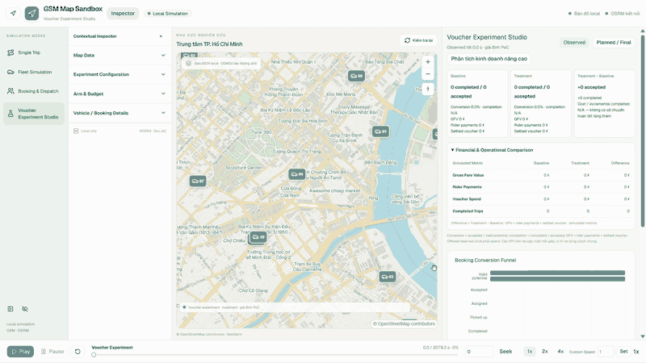

# GSM Map Sandbox

PoC mô phỏng hành trình, đội xe và voucher trên bản đồ OSM thật tại trung tâm TP.HCM, dùng OSRM chạy local. Booking, giá cước và voucher là giả định nghiên cứu, không phải dữ liệu vận hành hay GPS thực tế của GSM.

## GitHub features tích hợp — 12/10/2026

Local branch đã cập nhật tới GitHub `main` commit `71dd995`: A3 Booking & Dispatch, A4 Voucher Experiment Studio và A4.1 workspace/analytics/playback. Mặc định mở **Luồng demo 5 bước** từ ngày 13/10/2026: bài toán → WP1 → WP2 → WP3 → kết quả. **Mở bản đồ** mở campaign Quận 1; **Khám phá tuyến** mở công cụ nâng cao. Navigation giữ Một hành trình, Đội xe, Đặt và điều xe, Thí nghiệm voucher và **WP3 · Mô phỏng Quận 1**, thêm **Luồng demo** để quay lại trang đầu. URL `?mode=single|fleet|booking|voucher|wp3` mở thẳng từng công cụ.

A1–A4 dùng chung map/dock, custom speed chuẩn hóa1/2/4/8/16/32/64, Inspector và Analytics cuộn riêng. WP3 giữ clock/menu20×/60× và vùng cuộn riêng, model/support/accounting và API đã kiểm; chuyển sang workspace khác xóa scenario đang chạy. A4 dùng giả định fare/sigmoid riêng, không phải model `P_joint` hoặc bằng chứng H3 của WP3.

[Báo cáo merge và kiểm trên máy hiện tại](plans/20261012-github-feature-merge/reports/merge-result-vi.md). Báo cáo A3/A4/A4.1 trong `docs/` giữ nguyên evidence tác giả; dữ liệu/graph và primary evaluation cũ không được ghi đè.

## Gói demo dễ hiểu — 13/10/2026

Trang đầu dùng ví dụ xuất từ đúng bundle `P_joint` hiện tại: ba hồ sơ TRAIN, M1/M2 và các offer đủ support. Đây là số đọc đã lưu; không gọi inference live hoặc dùng ví dụ để chấm chất lượng. Tất cả kết quả và nguồn ghim checksum trong `frontend/public/demo/demo-content.json`; model/backend/protocol không đổi. PDF và guide nằm cùng thư mục, tải ở bước Kết quả.

Kết quả khóa: WP1 giảm log-loss **1,556% < 2%**; WP3 **1.536 → 1.537 chuyến, +0,065% < 5%**. Trần biết cả tương lai trên 36 tapes là **1.545**, trong khi 5% cần **1.613**. Trần chỉ áp dụng bộ cố định, không phải kết luận về khách thật. Các candidate operational/public-price là nghiên cứu riêng, chưa kích hoạt trên map. Có workload quá tải ngay baseline; service tương đối không chứng minh đạt ngưỡng tuyệt đối.

Kịch bản nhỏ hiện chạy: ba cách chọn cùng hoàn tất 10 chuyến; chi thực tế 0 / 15.000 / 10.000 ₫. Chỉ dùng để trình diễn. Map hiển thị số tại thời điểm playback; bảng và nhãn “cuối lượt” hiển thị tổng toàn lượt; bước Kết quả hiển thị evaluation đã khóa.

UI desktop/laptop/mobile, chọn xe/đổi policy/tua và JSON giữ chức năng. Công cụ sandbox từ GitHub vẫn dùng giả định riêng. Backend, OSRM và frontend chạy bằng `bash scripts/start-local.sh`; chỉ dừng bằng `bash scripts/start-local.sh stop` khi muốn tắt demo.

## WP3 — bản đồ HCM và simulation nghiệp vụ

Từ Luồng demo, mở WP3 với **mô hình WP1/WP2 đang dùng trên map**: đường OSM local, xe chạy geometry/thời gian từng đoạn OSRM. Bấm **Chạy mô phỏng**; hoàn tất tính toán thì tự phát ở 20×. Có thể tạm dừng, tua thời gian hoặc chọn xe. Cấu hình trình diễn mặc định là 3 xe / 18 báo giá / 8 phút / trần 50.000 ₫, mã `hcm-demo-20261013`; đây là lượt trình diễn riêng, không thay protocol đánh giá đã khóa. Mode này chuẩn bị 3 policy: không voucher, response-only và fleet rollout. Chuyển policy giữ cùng thời điểm và pause playback. Nút **JSON** xuất cấu hình, decisions, events, ledger, các tuyến, cost maturity và provenance. Mở thiết lập nâng cao, chọn **Sandbox cũ · xác suất giả định riêng** để xem 4 heuristic policy v2 cũ.

Nhu cầu/hành vi vẫn **synthetic**, không phải booking/GPS GMS. Mode tích hợp dùng predictor WP2 `P_joint` đã fit/calibrate trên cohort theo OD OSRM Quận 1; không xếp chồng xác suất WP1 vào WP2. Driver nhận100% sau khi được ghép đúng xe rảnh, còn hạn và có ETA OSRM nhỏ nhất. Giữ liability ngay khi phát offer; một customer request trong12phút; không request/hết hạn queue thì trả, hoàn tất thì tính gross cost. Immediate completion settlement là proxy adapter; pooled TRAIN full-refund kernel cho mature net cost riêng trong JSON. Không rút lại request-conditioned cost như một lần cancellation/completion nữa.

Hai ranking dùng cùng 32 paired rollouts, toàn phần campaign còn lại + clearance, forecast TRAIN và continuation response-only không recursive. Response-only xếp theo Δq; fleet rollout xếp theo gain chuyến hoàn tất. Snapshot bỏ heap/tương lai evaluator, pending episodes điều kiện theo thời gian chưa thấy request. Các paid offer thiếu support/budget/admission/service bị chặn. Mode v2 vẫn giữ luật reserve-on-booking/heuristic cũ. Chưa tích hợp OASIS/MiroFish hoặc nghiệm thu factual H2/H3.

Các policy dùng cùng quote stream và keyed random draws, cùng **trần ngân sách**, nhưng **chi thực tế khác nhau**. Bảng kết quả hiển thị số chi riêng; không dùng demo này để kết luận thắng ở đồng mức chi, tác động nhân quả hay SOTA. Vùng hiển thị là bbox trung tâm Quận 1 cũ và lân cận, có bờ sông phía Quận 4/Thủ Thiêm; không phải ranh giới hành chính.

### Map nhỏ Quận 1 và hiệu chỉnh OSM/OSRM

Luồng chính: **Chạy mô phỏng → tự phát/tua thời gian → chọn xe → Tìm xe trên map**. Danh sách xe dưới timeline giúp chọn cả khi marker chồng nhau; **Về vùng thử nghiệm** khôi phục góc nhìn. Nhãn địa điểm chỉ mở từ zoom 16 để tên đường và tuyến dễ đọc.

`config/region.json` có `simulation_bbox = [106.6935, 10.768, 106.7075, 10.782]`, khoảng **2,4 km²** quanh Bến Thành–Nguyễn Huệ–Lê Duẩn. Đây là vùng kỹ thuật trong coverage OSM đã xác minh; tuyến có thể đi vòng qua routing buffer. Coverage hiển thị, PBF và graph gốc giữ nguyên; không cần extract lại. Single Trip/Fleet cũ giữ sampling riêng.

Thời gian mặc định là **OSRM × 1,0**, theo lựa chọn chỉ dùng OSM của người dùng ngày 12/10/2026. Playback WP3 dùng `annotations=duration,distance` theo từng cặp tọa độ geometry đầy đủ, không chạy đều theo tổng chiều dài tuyến. OSRM annotations không gồm thời gian rẽ; playback phân bổ phần chênh lệch theo tỷ trọng thời gian đoạn để giữ đúng tổng duration của chặng. Đây là tốc độ car-profile ước tính, chưa được kiểm bằng GPS hoặc giao thông thực đo. JSON phiên bản `wp3-osrm-pilot-v2` lưu segment timing và provenance; báo cáo v1 cũ giữ nguyên.

**Khi có dữ liệu thực:** `scripts/calibrate-travel-times.py` fit một hệ số thời gian từ các chuyến độc lập. Input JSON gồm `source` mô tả nguồn và `trips`; mỗi chuyến có `id`, `split` (`train` hoặc `holdout`), `start`/`end` theo `[longitude, latitude]`, `observed_seconds` đo riêng thời gian di chuyển. Chốt split theo ngày/session trước khi fit; loại thời gian chờ, đón và dừng. Tool hỏi tuyến từ API local, fit weighted median chỉ trên train, báo MAE/MAPE/bias trên holdout và lưu provenance; không tự áp dụng. Hệ số giữ trong khoảng hiện có [1,3], báo rõ khi bị giới hạn.

```bash
python3 scripts/calibrate-travel-times.py --input observed-trips.json \
  --output plans/travel-calibration-run-01/report.json
```

Chưa có observations thì không có hệ số đã fit, sai số thực địa hoặc chứng nhận chất lượng traffic. [Review map và ảnh trước/sau](plans/20261012-q1-map-review/reports/map-review-vi.md).

### Giả định nhận booking — đã chốt 12/10/2026

Khách quyết định đặt theo xác suất response tại quote; `accepted` là **khách đã đặt**, không phải tài xế có thể từ chối. Sau đó dispatcher chọn xe **rảnh, đón kịp hạn, có ETA OSRM thấp nhất**; xe được chọn nhận booking với xác suất **100%**, không có lần rút ngẫu nhiên hay bộ lọc acceptance thứ hai. Bằng ETA thì chọn ID xe nhỏ nhất; một xe chỉ nhận một booking. Đây là giả định của pilot, không phải tỷ lệ tài xế GMS được đo.

Nếu chưa có xe phù hợp, booking chờ rồi có thể hết hạn. Không tự tạo xe, gán thêm chuyến cho xe bận, hoặc biến xác suất nhận 100% thành cam kết mọi booking được phục vụ. Nhu cầu tăng bởi voucher vẫn có thể đổi vị trí/availability và cạnh tranh năng lực. Hypothesis WP3 tiếp tục kiểm **fleet-aware voucher ranking so với response-only** dưới cùng dispatcher/WP2/menu/budget/service gates; gần nhất nhận chuyến là operating assumption, không phải contribution mới. Mode tích hợp đã có paired rollout và artifact WP2; kết quả engineering không thay factual acceptance.

### Bundle và kiểm integrated campaign

`POST /api/wp3/campaign` nhận cấu hình fleet/quotes/minutes/budget/patience/traffic cùng `response_scale` trong[0,1.5], mặc định1. Hệ số này chỉ thay evaluator; planner luôn dùng model đã fit. Mode cũ dùng `POST /api/wp3/simulate` và `voucher_effect`. Không tráo hai contract.

`config/campaign-model.json` pin SHA256 của `data/models/q1-campaign.json` (khoảng3MiB). Asset có exact logistic/Platt weights, contracts, train-only support/timing, 6000 anonymous synthetic train profiles và network. Không có oracle, customer IDs hoặc Test profiles. Thiếu/sai checksum hoặc network drift trả lỗi; không thay bằng xác suất tự đặt. Cache inference4096entry không lưu score/screen bị mutate. Histories/profile arrivals cố định là giả định short campaign, chưa mô hình recurrence hay response ngoài miền support; none ngoài miền dùng pooled train và log fallback, paid bị chặn.

Producer nằm trong GMS Research `p06-ai-product-demo/wp-lab`: `build.py --transport-network <catalog.json>` tạo run riêng; `export-campaign-bundle.py <run> <catalog.json> <output.json>` export từ native artifacts tin cậy. Sau refit phải cập nhật pin bằng digest mới, lưu old assets và khóa evaluation mới. Không cập nhật một protocol đang chạy.

```bash
python3 scripts/audit-campaign.py <JSON-xuất-từ-browser>
python3 scripts/evaluate-campaign.py <protocol.json> <output-directory> --workers 2
```

Audit dùng OSRM table bên ngoài kernel để tái kiểm nearest-idle, timing geometry và từng ledger prefix. Runner từ chối source/asset drift, giữ raw results/hashes, resume các world có index đã xác minh. Protocol chọn M/menu/tolerances/screens/seeds trước Evaluation; bootstrap theo seed giữ cả workload chung. CI là conditional simulation-world uncertainty, không phải ngày GMS held out hoặc causal uncertainty.

[Báo cáo tích hợp và kết quả](plans/20261012-integrated-campaign/reports/integrated-result-vi.md): primary36worlds có1537 vs1536completed, +0,065%; CI chứa0, chưa đạt5%. Gross subsidy giảm72,4% với relative service gates pass; tải cao vẫn vi phạm absolute service limit ngay trong no-offer baseline. Không coi tiết kiệm chi là primary H3 pass. Các artifacts/pilot v2 và kết quả âm cũ được giữ.

### Headless campaign trên Kaggle CPU

```bash
python3 scripts/package-kaggle-campaign.py <thư-mục-output-mới>
python3 <output>/main.py --package <output>/campaign-bundle.zip --output <local-smoke-dir> --smoke
```

Packager chỉ lấy frozen source/assets/protocol và helper dependency; từ chối code/model drift. Output có archive, runner và hướng dẫn private Dataset/Notebook. Runner dùng Python standard library, hai CPU workers, không GPU/PBF/OSRM server hoặc pip install. Smoke dùng seed/output riêng; bỏ `--smoke` mới chạy144worlds original. `/kaggle/working` giữ outputs khi Save & Run All; tải index/summary/raw JSON về để kiểm hash. Local smoke đã chạy; chưa upload/chạy Kaggle. Map viewer vẫn local. Không thay model/protocol từ Test.

### Chạy trên macOS/Linux bằng Docker

Cần Docker Desktop/Linux Engine và graph đã chuẩn bị. Tại thư mục repo:

```bash
bash scripts/start-local.sh
# Mở http://127.0.0.1:5173
# API: http://127.0.0.1:8000/docs · OSRM: http://127.0.0.1:5001
bash scripts/start-local.sh stop
```

Script dựng frontend/backend và chạy 3 service với host ports chỉ bind loopback. Backend chia sẻ network namespace với OSRM để giữ contract router local. Port 5001 tránh AirPlay macOS đang dùng 5000. Cần giữ nguyên absolute project path trong metadata PBF; nếu di chuyển repo, chạy lại verification/pipeline tại đường dẫn mới. `WP3_PROJECT_ROOT` được script cấp tự động. Lỗi thiếu dữ liệu/không có tuyến trả lỗi có cấu trúc; không có đường giả hoặc router bên ngoài. Chỉ chuẩn bị một scenario tại một thời điểm, tối đa 2 route requests đồng thời. Đóng tab hủy fetch/playback ở frontend; server có thể tiếp tục hoàn tất lần chuẩn bị đã bắt đầu.

Nếu chưa có dữ liệu, tải **snapshot đã dùng trong báo cáo** rồi chạy pipeline bằng Python với dependencies trong `backend/requirements.lock.txt` và Docker:

```bash
mkdir -p data/raw
curl --fail --location https://download.geofabrik.de/asia/vietnam-261009.osm.pbf --output data/raw/vietnam-latest.osm.pbf
# MD5 chính thức của snapshot: a9ed1c0a40bbf304d1c743560512fbb6
python3 scripts/pipeline.py verify
python3 scripts/pipeline.py extract
python3 scripts/pipeline.py display
python3 scripts/pipeline.py routing
bash scripts/start-local.sh
```

`config/region.json` quyết định bbox, buffer và cách extract; pipeline xác minh PBF, lưu source/extract/render/graph hashes. WP3 lấy điểm snap canonical và hints từ OSRM **table** để geometry và ma trận cùng vị trí; nearest độc lập có thể chọn đoạn không kết nối được. Bản đồ/tuyến không cần tile, glyph, font server hoặc API trả phí; font và worker phục vụ local. Giữ attribution [OpenStreetMap](https://www.openstreetmap.org/copyright) khi chia sẻ sản phẩm dữ liệu.

Audit độc lập cho stack đang chạy:

```bash
docker exec gsm-map-wp3-backend-1 python scripts/audit-wp3.py --osrm http://127.0.0.1:5000 --output /tmp/wp3-audit
docker cp gsm-map-wp3-backend-1:/tmp/wp3-audit/. plans/20261012-hcm-q1-wp3/reports/
```

[Báo cáo WP3](plans/20261012-hcm-q1-wp3/reports/wp3-hcm-report-vi.md) ghi dữ liệu, kết quả, kiểm thử và giới hạn của lần chạy thực tế. Các báo cáo A1/A2 cũ là bằng chứng của tác giả trên môi trường Windows; không ghi đè bằng lần chạy này.

## Chạy trên Windows
## Video demo



GIF là bản xem trước 10 giây để GitHub hiển thị trực tiếp. [Mở hoặc tải video đầy đủ (MP4)](docs/media/gsm-map-sandbox-demo.mp4).

## Chạy ứng dụng Live trên Windows

Cần Python 3.11+, Node.js 20.19+ hoặc 22.12+, và Docker Desktop với Linux Engine. PBF, GeoJSON và graph OSRM không được lưu trong Git; cần có dữ liệu và artifact đã chuẩn bị theo [báo cáo A1](docs/A1-report.md). Không chạy lại pipeline dữ liệu nếu artifact hiện có đã dùng được.

Tại PowerShell, từ project root:

```powershell
if (-not (Test-Path .venv)) { py -3.11 -m venv .venv }
.\.venv\Scripts\python.exe -m pip install -r backend\requirements.lock.txt
if (-not (Test-Path .env)) { Copy-Item .env.example .env }
Set-Location frontend
npm.cmd ci
Set-Location ..
```

Lần đầu, tạo dữ liệu bản đồ và router (cần Docker Linux Engine):

```powershell
docker pull iboates/osmium:1.19.0
docker pull ghcr.io/project-osrm/osrm-backend:v5.27.1
.\.venv\Scripts\python.exe scripts\pipeline.py verify
.\.venv\Scripts\python.exe scripts\pipeline.py extract
.\.venv\Scripts\python.exe scripts\pipeline.py display
.\.venv\Scripts\python.exe scripts\pipeline.py routing
.\.venv\Scripts\python.exe scripts\pipeline.py serve --detach
```

Sau đó mở hai terminal tại thư mục repo:

```powershell
.\.venv\Scripts\python.exe -m uvicorn backend.app.main:app --host 127.0.0.1 --port 8000 --reload --reload-dir backend
```

```powershell
Set-Location frontend
npm.cmd run dev
```

Mở ứng dụng tại <http://127.0.0.1:5173>; API docs tại <http://127.0.0.1:8000/docs>. Nếu graph và dữ liệu đã được tạo, bỏ qua bước pipeline và chỉ chạy `serve --detach`.

## Trải nghiệm Booking & Dispatch (A3)

Chọn **Booking & Dispatch** trong menu, giữ mặc định **5 xe / 20 bookings**, seed `hcm-booking-2026`, rồi bấm **Generate Booking Scenario**. Backend chuẩn bị các quyết định điều phối và tuyến đón/chở khách bằng OSRM local trước khi mở Play. Xe được chọn theo ETA, không theo khoảng cách đường thẳng.

Dùng Playback Dock ở cuối màn hình: Play/Pause/Resume, slider, **Seek seconds**, Reset, 1x/2x/4x hoặc Custom Speed tới 64x. Chọn booking hoặc xe để focus; **Fit vùng scenario** đưa bản đồ về vùng demo. Playback/Seek không tính lại routing. Single Trip và Fleet Simulation vẫn hoạt động.

Low trải request đều có jitter; Medium sinh thời điểm đều theo seed; High dồn request trong ¼ đầu horizon. Mặc định horizon 1800 s, giới hạn chờ **tới lúc được đón** 300 s. Tối đa 10 xe / 30 bookings. Để thử unserved: 1 xe, 30 bookings, High, horizon 60 s, max wait 10 s.

Metrics **Observed** chỉ tính đến simulation time; **Planned** tính toàn scenario. Đây là demand/dispatch mô phỏng, không phải dữ liệu hành khách hoặc GPS GSM thực tế; thời gian chạy là ước tính profile OSRM, không live traffic.

API mới: `POST /api/booking-simulation/prepare`. Chi tiết model, chính sách, giới hạn và bằng chứng: [báo cáo A3](docs/A3-report.md).

Kiểm thử và audit (giữ nguyên PBF/graph, không preprocess):

```powershell
$env:RUN_REAL_DATA='1'
.\.venv\Scripts\python.exe -m pytest -q --basetemp=data/processed/pytest-a3-manual
Remove-Item Env:\RUN_REAL_DATA
.\.venv\Scripts\python.exe scripts\audit_bookings.py
# Cần browser-qa.json đã ghi từ browser QA để chạy audit vị trí:
.\.venv\Scripts\python.exe scripts\audit_booking_positions.py
Set-Location frontend
npm.cmd test
npm.cmd run build
```

## Trải nghiệm Voucher Experiment Studio (A4)

Bốn chế độ Single Trip, Fleet Simulation, Booking & Dispatch và Voucher Experiment Studio dùng chung bản đồ/dock. Primary Navigation còn có WP3 · Fleet rollout để trở về workspace campaign Quận1.

Với artifact A1 đã có, **không chạy lại extract/display/routing**. Từ PowerShell tại project root, kiểm tra process/port trước khi mở thêm terminal:

```powershell
Set-Location 'D:\ThS\VinAI\Phase3_VRIC\gsm-map-sandbox'
docker ps --filter name=gsm-map-osrm
Get-NetTCPConnection -State Listen -LocalPort 5000,8000,5173 -ErrorAction SilentlyContinue
# Nếu router đã tồn tại nhưng stopped:
docker start gsm-map-osrm
```

Mở hai terminal tại project root. Chạy backend trong terminal thứ nhất:

```powershell
.\.venv\Scripts\python.exe -m uvicorn backend.app.main:app --host 127.0.0.1 --port 8000 --reload --reload-dir backend
```

Chạy frontend trong terminal thứ hai:

```powershell
Set-Location frontend
npm.cmd run dev
```

Mở <http://127.0.0.1:5173>. Chọn một trong bốn chế độ: **Single Trip**, **Fleet Simulation**, **Booking & Dispatch** hoặc **Voucher Experiment Studio**. API docs ở <http://127.0.0.1:8000/docs>. Nếu OSRM container đang chạy, bỏ qua `docker start`. Nếu graph đã có nhưng container chưa được tạo, chạy `python scripts\pipeline.py serve --detach`. Kiểm tra port 5000, 8000 và 5173 trước nếu ứng dụng đã mở.

Nếu chưa có PBF, bản đồ/render GeoJSON hoặc graph OSRM, xem [hướng dẫn dữ liệu A1](docs/A1-report.md). Không có fallback sang dịch vụ bản đồ hay routing công cộng.

## Saved Replay và Batch Analysis

Saved Replay chạy riêng, không cần FastAPI hoặc OSRM. Sau khi có render assets và sample A4 trên máy, trong PowerShell:

```powershell
Set-Location frontend
npm.cmd ci
npm.cmd run package:replay
npm.cmd run verify:replay
npm.cmd run build
Set-Location ..
py -3 scripts\serve_replay.py
```

Mở <http://127.0.0.1:4173/?runtime=saved> rồi chọn **Load Saved Demo** hoặc import file **Export Portable v1**. Server chỉ phục vụ static files và chặn `/api/*`. Khi chia sẻ demo, gửi thư mục `frontend/dist` đã build; không cần gửi PBF hay graph OSRM.

Batch cần Live backend và OSRM: trong Voucher Experiment Studio, Prepare Experiment rồi mở **Phân tích kinh doanh nâng cao → Batch Experiment Analysis**. Hướng dẫn batch, định nghĩa chỉ số và giới hạn được ghi trong [báo cáo A5](docs/A5-report.md). Legacy A4 JSON cần đóng gói trước khi import vào Saved Replay; xem README A5 trong báo cáo để biết lệnh.

## Tài liệu theo giai đoạn

- [A1 — bản đồ và routing local](docs/A1-report.md)
- [A2 — mô phỏng đội xe](docs/A2-report.md)
- [A3 — booking và điều phối](docs/A3-report.md)
- [A4 — voucher experiment](docs/A4-report.md)
- [A4.1 — workspace và responsive UI](docs/A4.1-report.md)
- [A5 — Saved Replay, batch analysis và handoff WP3](docs/A5-report.md)
- [A5 — hướng dẫn tích hợp WP3](docs/A5-integration-handoff.md)

## Public replay build

`VITE_PUBLIC_REPLAY=1 npm --prefix frontend run build -- --base=/map/` exports the guided demo and verified WP3 playback. This build requires the companion static `/map-runtime/` package from the research demo (OSM layers, dataset metadata, verified campaign JSON). It performs no live routing or scenario generation. Live local mode retains A1–A5, including saved replay import and batch analysis.
