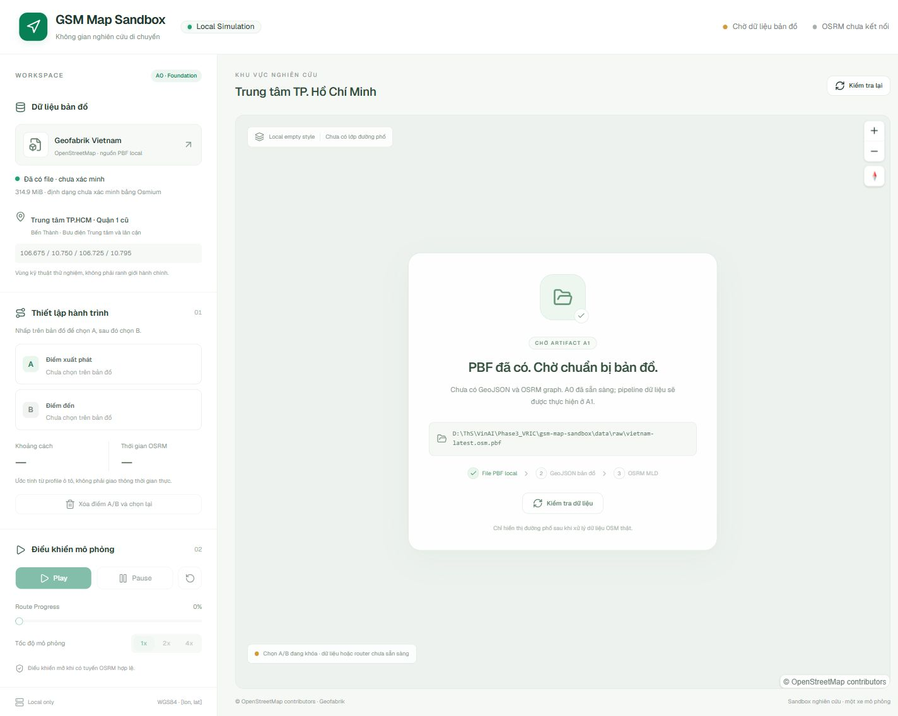

# Báo cáo bàn giao A0 — GSM Map Sandbox

Ngày: 2026-10-11 (Asia/Saigon). A0 hoàn tất phần có thể thực hiện độc lập với pipeline dữ liệu. **Dừng tại A0; chưa thực hiện A1.**

## 1. Tổng quan

Đã tạo React/Vite/TypeScript dashboard tiếng Việt, Tailwind v4, shadcn/ui, mapcn thực sự và MapLibre. Map dùng local empty style, worker/shared module và font local. Có header trạng thái, sidebar PBF/bbox, A/B, route metrics và playback; controls khóa khi chưa sẵn sàng.

FastAPI đọc cấu hình từ project root, xử lý missing/unreadable/empty/invalid-extension PBF; schema WGS84; route gọi OSRM local với snap limit và structured errors. Đã chuẩn bị script GIS và OSRM MLD, provenance/manifest và no-overwrite checks.

Phát hiện file PBF **đã có từ trước lúc A0** dù prompt mô tả chưa sao chép. File được giữ nguyên; không dùng sự hiện diện này để tự chuyển sang A1.

## 2. Cây thư mục thực tế (rút gọn)

```text
gsm-map-sandbox/
├── .env.example
├── .gitignore
├── README.md
├── pytest.ini
├── frontend/
│   ├── components.json
│   ├── package.json / package-lock.json
│   ├── vite.config.ts / vitest.config.ts / tsconfig*.json
│   ├── index.html
│   ├── scripts/copy-map-worker.mjs
│   ├── public/ (favicon, local MapLibre worker/shared module)
│   ├── src/
│   │   ├── App.tsx / App.css / index.css / main.tsx
│   │   ├── components/sandbox-map.tsx
│   │   ├── components/ui/ (map, button, badge, slider, card, separator)
│   │   ├── lib/ (api, playback, use-playback, utils)
│   │   ├── vendor/ (shadcn CSS và MIT license)
│   │   └── test-setup.ts
│   └── tests/ (dashboard.test.tsx, playback.test.ts)
├── backend/
│   ├── requirements.txt / requirements.lock.txt
│   └── app/ (config.py, dataset.py, schemas.py, main.py)
├── scripts/ (pipeline.py, start-backend.ps1, start-frontend.ps1)
├── config/region.json
├── data/
│   ├── raw/ (.gitkeep, vietnam-latest.osm.pbf do người dùng cung cấp)
│   ├── extracted/ (.gitkeep)
│   ├── processed/ (.gitkeep)
│   └── routing/ (.gitkeep)
├── tests/ (.gitkeep, test_backend.py)
└── docs/
    ├── A0-report.md
    └── evidence/ (a0-desktop.jpg, a0-mobile.jpg)
```

.venv, node_modules, dist và cache được tạo khi cài/kiểm thử, nhưng bị ignore. Không init nested Git: Git root được phát hiện là D:/ThS/VinAI, ngoài thư mục app này.

## 3. Phiên bản đã cài và kiểm thử

| Thành phần | Phiên bản |
|---|---|
| Node / npm | 24.18.0 / 11.16.0 |
| Python trong .venv | 3.11.9 |
| React / React DOM | 19.3.0 |
| Vite / TypeScript | 8.3.4 / 6.0.3 |
| Tailwind / plugin Vite | 4.3.3 |
| MapLibre GL JS | 6.13.0 |
| shadcn CLI dùng để sinh component | 4.21.4 (CLI không giữ trong runtime dependencies) |
| mapcn | Source từ registry @mapcn/map, kiểm tra API theo docs hiện hành |
| Base UI / Lucide | 1.9.0 / 1.55.0 |
| FastAPI / Pydantic / pydantic-settings | 0.143.0 / 2.14.0 / 2.15.0 |
| Uvicorn / HTTPX / pytest | 0.54.0 / 0.28.1 / 9.1.1 |
| Vitest / jsdom | 5.0.3 / 30.1.2 |

Package-lock frontend và requirements.lock backend ghi dependency chính xác. npm audit cuối: 0 vulnerabilities. pip check: không có dependency hỏng.

## 4. API và website đã chạy được

Đã chạy thực tế Vite tại http://127.0.0.1:5173 và Uvicorn tại http://127.0.0.1:8000. Đã xác nhận socket listen ở **127.0.0.1**, không bind 0.0.0.0. Server thử nghiệm được dừng sau QA; người dùng khởi động lại theo phần 5.

- GET /api/health: HTTP 200, backend_ready true.
- GET /api/dataset/status: HTTP 200, state artifacts_pending, ready false; PBF present_unverified; map_ready/graph_ready false; OSRM unavailable.
- Frontend và worker local: HTTP 200.
- GET /api/map/streets: structured DATASET_NOT_READY trước khi có GeoJSON (unit test).
- POST /api/route: HTTP thực trả 503 DATASET_NOT_READY khi chưa có graph. Schema và error guards hoạt động qua TestClient; unit test dùng MockTransport cho OSRM, không phải routing Quận 1.

Swagger có tại /docs khi backend chạy. API không có upload file hoặc public router fallback.

## 5. Lệnh PowerShell

Backend — terminal 1:

```powershell
Set-Location 'D:\ThS\VinAI\Phase3_VRIC\gsm-map-sandbox'
# Khi cần dựng lại môi trường:
py -3.11 -m venv .venv
.\.venv\Scripts\python.exe -m pip install -r backend\requirements.lock.txt

.\.venv\Scripts\python.exe -m uvicorn backend.app.main:app --host 127.0.0.1 --port 8000 --reload --reload-dir backend
```

Frontend — terminal 2:

```powershell
Set-Location 'D:\ThS\VinAI\Phase3_VRIC\gsm-map-sandbox\frontend'
npm.cmd install
npm.cmd run dev
```

Hai script .ps1 dùng $PSScriptRoot, UTF-8 BOM, cú pháp đã parse bằng Windows PowerShell 5.1 và PowerShell 7. Không cần thay đổi execution policy: có thể dùng trực tiếp lệnh Python/npm ở trên.

## 6. Kết quả kiểm thử

| Kiểm tra | Kết quả | Bằng chứng/phạm vi |
|---|---|---|
| Frontend production build + TypeScript | PASS | npm.cmd run build, exit 0 |
| Typecheck riêng | PASS | npm.cmd run typecheck, exit 0 |
| Backend import/compile/startup | PASS | import app, compileall, Uvicorn startup complete |
| Backend unit/API/schema tests | PASS | 29 passed |
| UI/playback unit tests | PASS | 9 passed; fixture, WebGL được mock |
| Missing PBF lifecycle | PASS | TestClient: backend startup, missing_pbf, route 503, không fallback |
| Config path độc lập CWD; local URL enforcement | PASS | pytest |
| API OSRM errors và snap limit | PASS | MockTransport: NoRoute/NoSegment/offline/malformed/snap too far |
| Playback geometry, speed, seek, reset, request cancellation | PASS | Vitest; geometry fixture có góc rẽ |
| HTTP frontend/worker/health/status | PASS | Invoke-WebRequest/Invoke-RestMethod |
| Browser desktop 1440×1000 và mobile 390×844 | PASS | Canvas MapLibre thật, refresh/zoom, controls disabled, không tràn ngang ở mobile; console không có warn/error |
| PowerShell parse 5.1/7 | PASS | Parser.ParseFile cho cả hai .ps1 |
| Pipeline dry-run | PASS | 5 action, test chặn mọi subprocess; chỉ in plan |
| npm audit / pip check | PASS | 0 vulnerabilities / no broken requirements |
| Ignore PBF/node_modules/dist/.venv | PASS | git check-ignore |
| Xác minh định dạng PBF bằng Osmium | BLOCKED | Osmium chưa có trong PATH; chưa chạy verify |
| Extract và export dữ liệu OSM thật | BLOCKED | Prerequisite Osmium; nằm ngoài A0, chưa chạy |
| Preprocess / khởi động OSRM MLD | BLOCKED | Docker engine chưa chạy, chưa có extract/graph; nằm ngoài A0 |
| Tuyến/snap/turn restrictions/playback trên đường thật | BLOCKED | Chưa có GeoJSON và graph, chưa chạy A1 |

Không còn FAIL ở kiểm tra cuối. Build có cảnh báo chunk MapLibre lớn (~1.37 MB JS trước gzip); không làm build fail. pytest có một deprecation warning từ Starlette TestClient với httpx, không có test fail. Đây không phải chứng nhận hiệu năng/production hay kiểm chứng routing Quận 1.



## 7. Phụ thuộc hệ thống

- Node, npm, Python 3.11/3.12/3.13: đã có. Dự án dùng .venv Python 3.11.9.
- Docker CLI 29.6.2: có. Docker API Linux engine không kết nối được tại thời điểm kiểm tra.
- Osmium CLI: không tìm thấy trong PATH.
- WSL2 backend: chưa xác minh vì engine chưa chạy. Cần người dùng chuẩn bị Linux containers nếu dùng Docker Desktop.
- Không cài system software, không bật WSL/virtualization, không đổi cấu hình máy.

## 8. Đường dẫn PBF

```text
D:\ThS\VinAI\Phase3_VRIC\gsm-map-sandbox\data\raw\vietnam-latest.osm.pbf
```

**File đã có, không cần sao chép lại.** Size: 330,248,138 byte (314.9 MiB). SHA-256 trước và sau A0 giống nhau:

```text
2FBD2EE6B4DC151EECF04FA6823CDDF584B47423E190118B10FCE8B6115E9D8A
```

Hash chỉ chứng minh file không đổi trong A0; không chứng minh định dạng PBF hợp lệ hay provenance Geofabrik. Backend mặc định đọc đúng đường dẫn này; OSM_PBF_PATH có thể override từ .env.

## 9. A1 sau khi người dùng yêu cầu tiếp tục

Chuẩn bị Osmium và Docker engine; verify PBF; extract bbox có buffer, kiểm tra references/restrictions; export GeoJSON và đánh giá kích thước; preprocess graph car MLD; chốt image tag/digest; chạy router local. Sau đó kiểm chứng đường phố thật, chọn A/B, snap, NoRoute/NoSegment, playback, reset và tương tác responsive trên dữ liệu thật. Đánh giá kết nối ở rìa và attribution của artifact.

Không thực hiện các bước này trong A0 dù PBF đã có.

## 10. Xác nhận phạm vi

Không tạo, chỉnh sửa hoặc xóa file trong repository **gms-voucher-research-demo**. Git status của repository đó sạch lúc bắt đầu và lúc kết thúc. Mọi file ứng dụng/artifact QA nằm trong gsm-map-sandbox. Không dùng đường dẫn tương đối sang repository đó; không kết nối GSM, commit, push, deploy, tải PBF, gọi OSM/Overpass/public OSRM hoặc sinh đường phố giả.

