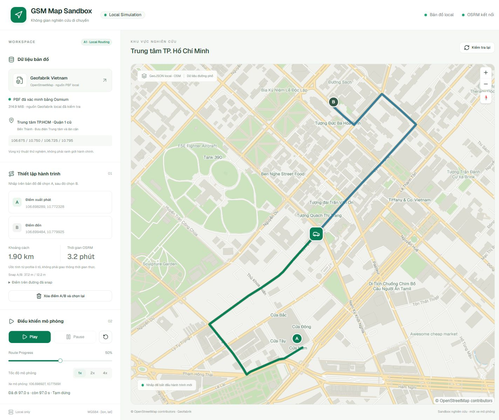
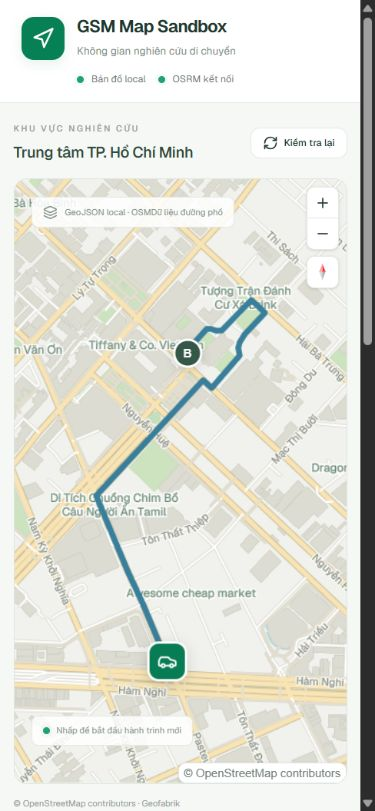

# Báo cáo A1 — GSM Map Sandbox

Ngày thực thi: **2026-10-11**, Asia/Saigon. Workspace: `D:\ThS\VinAI\Phase3_VRIC\gsm-map-sandbox`.

## 1. Executive Summary — GO A2 trong phạm vi PoC

**A1 hoàn tất:** bản đồ đường phố thật hiển thị từ server local, OSRM MLD local tính tuyến mới sau click A/B, một xe đi theo full OSRM geometry qua mapcn `MapRoute`, `RouteProgress`, `RouteMarker at="progress"` và `MarkerContent`. Play/Pause/Resume/Reset/Seek/1x/2x/4x/completed đã kiểm tra trong browser WebGL desktop và mobile.

| Nhóm nghiệm thu độc lập | Kết quả |
|---|---|
| Map rendering từ OSM thật, coverage, attribution | PASS |
| OSRM local, graph hoàn tất, tuyến mới và snapping | PASS |
| Một xe mapcn playback, controls, thay tuyến | PASS |
| Baseline/regression/build/browser | PASS |
| Hai input PBF không thay đổi; không external fallback | PASS |

GO là cho sandbox nghiên cứu, không phải chứng nhận toàn bộ mạng đường/luật giao thông. Có 10 restriction node-via được thử thật; còn giới hạn tại mục 12. **Dừng sau A1; chưa thực hiện A2, không commit/push.**

## 2. Các thay đổi chính

Tiếp tục implementation A0; giữ dashboard, REST contract, playback state machine và component mapcn đã có. Không tạo dự án mới.

| File | Thay đổi |
|---|---|
| `backend/app/config.py`, `.env.example` | Pin OSRM v5.27.1 và Osmium 1.19.0; map path vào render directory |
| `backend/app/dataset.py` | PBF verification cache; manifest/artifact checks; `.incomplete`; tách graph_built/graph_ready |
| `backend/app/main.py`, `schemas.py` | Allowlist map layers, timeout riêng, validate geometry/metrics/bbox/snap/anchors |
| `scripts/pipeline.py` | Hoàn thiện pipeline cũ: Docker Osmium, readonly input, digest locks, reuse/no overwrite, working copy, MLD/serve |
| `scripts/render_data.py` | Validate/reduce export thực từ Osmium, tách 5 lớp GeoJSON |
| `scripts/audit_dataset.py` | Coverage comparison, restriction refs, local connectivity/oneway/restriction smoke |
| `frontend/src/lib/map-style.ts` | Native MapLibre layers: road casing/classes/labels, water, green, buildings, places; fonts local |
| `frontend/src/components/sandbox-map.tsx` | Native basemap sources trong mapcn; fit route; một progress marker |
| `frontend/src/components/ui/map.tsx` | Registry default chuyển sang blank local để không fallback CARTO |
| `frontend/src/App.tsx`, `App.css`, `lib/api.ts` | A1 labels, verified PBF, elapsed/remaining/completed, snap details, error code, reset khi chọn ngoài vùng |
| `frontend/index.html` | CSP nguồn local cho trang ứng dụng |
| `tests/test_backend.py`, `tests/test_a1.py` | Giữ 29 baseline tests; nâng fixture cho manifest/LineString và thêm regression/integration |
| `frontend/tests/dashboard.test.tsx`, `playback.test.ts` | Late response, loading/error, completion/unmount cleanup |
| `README.md`, `docs/evidence/a1/*` | Khởi chạy/tái tạo/giới hạn và bằng chứng thực thi |

`config/region.json`, package manifests/locks và logic `playback.ts`/`use-playback.ts` được tái sử dụng. Không thêm package hệ thống, authentication, database hoặc cloud.

## 3. Source integrity: checksum trước/sau

Hai artifact đầu vào không bị xóa, đổi tên, di chuyển hoặc ghi đè:

| Input | Bytes | SHA-256 trước và sau | Kết quả |
|---|---:|---|---|
| `data/raw/vietnam-latest.osm.pbf` | 330,248,138 | `2FBD2EE6B4DC151EECF04FA6823CDDF584B47423E190118B10FCE8B6115E9D8A` | PASS, khớp A0/người dùng |
| `data/processed/hcm-q1.osm.pbf` | 1,321,521 | `48B3FD8935B55F65D1A7E4296016A62C36D704B77EE1329F2BA0BEB4F978D3DC` | PASS, nguyên vẹn |

Bằng chứng: [preflight](evidence/a1/preflight.json), [checksum sau](evidence/a1/input-integrity-after.json). Hash được đọc streaming, không load national PBF vào RAM. Input mount readonly trong Docker; OSRM không chạy trực tiếp trên hai file này. Không tải PBF thay thế, không OSM/Overpass/public OSRM.

## 4. Preflight và versions

Baseline tự chạy lại: **29 backend / 9 frontend PASS**, frontend typecheck/build PASS. Docker Linux Engine hoạt động; không cần chỉnh Docker Desktop/WSL2/BIOS hoặc quyền admin.

| Công cụ/môi trường | Kết quả agent xác minh |
|---|---|
| Docker CLI / Engine | 29.6.2, Linux/amd64, Docker Desktop 4.84 |
| Docker resources trước preprocess | 8 CPU, khoảng 7.65 GiB RAM |
| Host memory trước xử lý | 16,551,224 KiB total; 3,651,512 KiB available |
| Drive D free trước xử lý | 46,099,279,872 bytes, khoảng 43 GiB |
| Osmium container | 1.19.0 / libosmium 2.23.1 |
| Windows Osmium CLI | Không trong PATH; **không phải blocker** |
| Python | 3.11.9 |
| FastAPI / Pydantic / HTTPX / Uvicorn | 0.143.0 / 2.14.0 / 0.28.1 / 0.54.0 |
| React / Vite / TypeScript / Tailwind / MapLibre | 19.3.0 / 8.3.4 / 6.0.3 / 4.3.3 / 6.13.0 |

Packages A0 được giữ nguyên; mapcn/shadcn là source registry trong project, không phải runtime package tải từ CDN. Versions đầy đủ: [frontend](evidence/a1/frontend-packages.json), [Python](evidence/a1/python-versions.json), [Docker version](evidence/a1/docker-version.txt), [Docker info](evidence/a1/docker-info.txt).

Đã cân nhắc raw max node ID ~14.27 tỷ và dense bitset memory trước extraction. Chạy tuần tự, extraction giới hạn 5 GiB/4 CPU, OSRM preprocess 2 GiB/4 CPU. OSRM log báo peak RAM extract 107,757,568 bytes; partition 39,907,328; customize 25,022,464. Không preprocess toàn Việt Nam. Docker có warning về blkio throttle/cgroup v1 nhưng các job hoàn tất; không đổi cấu hình máy để xử lý warning này.

## 5. Manual artifact và quyết định extraction

**Bằng chứng người dùng cung cấp trước A1:** manual extract dùng `complete_ways`, bbox `[106.680,10.760,106.720,10.800]`, size 1,321,521 bytes; Osmium Docker đọc được. Agent không nhận bước thủ công đó là toàn bộ A1 đã PASS.

**Agent tự xác minh:** full `fileinfo -e -j` cho raw và manual đều hoàn tất, object ordering hợp lệ, không multiple versions. Timestamp header raw `2026-10-09T20:21:04Z`.

| Dataset | Nodes | Ways | Relations |
|---|---:|---:|---:|
| Vietnam raw | 46,394,305 | 4,730,057 | 26,680 |
| Manual `hcm-q1.osm.pbf` | 87,560 | 16,626 | 927 |
| New buffered `hcm-center.osm.pbf` | 242,544 | 51,495 | 1,909 |

Manual `check-refs` có 0 node thiếu trong way. Audit riêng tìm 394 restriction relation, **14 missing way members**, 7,780 road features và 1,471 oneway ways. Bbox manual không chứa display bbox; các way/node ngoài bbox do complete ways không chứng minh coverage đầy đủ.

**Không dùng manual artifact làm OSRM input.** Lý do tái trích có bằng chứng: thiếu coverage và restriction members, không phải đổi tên/thư mục. Manual file được giữ nguyên để đối chiếu.

| Cấu hình thực tế | Giá trị |
|---|---|
| Display bbox | `[106.675,10.750,106.725,10.795]`, không thu hẹp |
| Extraction/routing bbox | `[106.660,10.735,106.740,10.810]` |
| Buffer | 0.015° mỗi phía, khoảng 1.6 km ở khu vực này |
| Strategy / parameters | `smart -S types=multipolygon,restriction --set-bounds` |
| Extract mới | `data/extracted/hcm-center.osm.pbf` |
| Extract size / SHA-256 | 3,290,221 bytes / `3a939d15ac7b775aba3f5a0324064ceb3d1b19ab0d176f2b10b94448c36afda0` |
| Process time | `2026-10-11T14:51:04Z` (21:51 giờ Việt Nam), theo extract metadata |
| OSRM working copy | `data/routing/hcm-center.osm.pbf`, cùng hash extract mới |

Theo [Osmium extract](https://docs.osmcode.org/osmium/latest/osmium-extract.html), smart hoàn thiện relation type đã chọn; complete_ways hoàn thiện ways nhưng không đảm bảo đầy đủ relation members. New extract `check-refs`: **0 missing way nodes**; audit 741 restriction relations: **0 missing node/way members**. Data bbox mới vẫn rộng hơn extraction bbox (`106.5695365,10.3486896,107.0669174,10.8906182`) do complete geometry; không dùng nó để suy luận coverage.

Coverage trong display bbox: manual 6,666 road ID, mới 10,830; **4,164 road ID mới vắng trong manual**. Lưới 5×5 vertices cho hàng phía nam tăng từ `[2,36,8,24,11]` lên `[3137,2320,2589,1853,1688]`. Đây là so sánh geometry thật, không chỉ `fileinfo`. Mạng ô tô còn được kiểm tra độc lập bằng OSRM ở mục 8.

Bằng chứng: [raw fileinfo](evidence/a1/source-fileinfo.json), [manual fileinfo](evidence/a1/manual-fileinfo.json), [manual audit](evidence/a1/manual-audit.json), [new graph audit](evidence/a1/graph-audit.json), `data/extracted/hcm-center.osm.metadata.json`, `docs/evidence/a1/extract.log`.

## 6. GeoJSON và map rendering

Osmium đọc PBF thật, tags-filter/export geometry; Python chỉ reduce/validate export, không tự parse PBF. Routing PBF giữ đầy đủ tags, kể cả đường nhỏ/không tên/oneway/access. Render subset không được dùng để dựng graph.

| Layer | Features | Bytes |
|---|---:|---:|
| `streets.geojson` | 15,281 | 4,124,871 |
| `water.geojson` | 124 | 229,554 |
| `green.geojson` | 471 | 256,391 |
| `buildings.geojson` | 12,785 | 3,642,002 |
| `places.geojson` | 93 | 16,117 |
| **Tổng phục vụ browser** | **28,754** | **8,268,935 (~7.89 MiB)** |

File nằm ở `data/processed/render/`; manifest có feature count, size, SHA-256, extract provenance và attribution. Export trung gian 73,701 features, bỏ 27,467 ngoài render bbox, không phát hiện duplicate geometry feature. Chỉ giữ các thuộc tính render. Kiểm tra geometry type, finite WGS84, line length và closed polygon rings; integration tests validate tất cả output.

Render bbox = display + 0.005°. GeoJSON nhỏ và browser zoom/pan hoạt động, chưa có cơ sở chuyển sang tiles/PMTiles. Không simplify geometry tuyến OSRM. Native MapLibre layers tạo basemap hoàn chỉnh qua wrapper mapcn: đường phân màu/classes/casing, nhãn đường theo zoom, mặt nước/kênh, công viên, buildings và OSM POI. Có attribution, không DOM marker cho mỗi đường và không SVG map giả.



## 7. OSRM MLD và container

Image chính thức GHCR: `ghcr.io/project-osrm/osrm-backend:v5.27.1`, version thực tế `v5.27.1`.

```text
OSRM digest:
sha256:855614a38f464b0558a2ad6eaa7cb8c139f39887da9b38b485ce453c6e6e6124
Osmium digest:
sha256:a67987f7d822d951ae1979de656ab7bd8051605f79d2751ea4800cc6057124be
car.lua SHA-256:
cb3df0546318665609606b746a1297f3d65ca3c2ff825f8a6f3c57247d86a2d3
```

Chạy extract → partition → customize trên **working copy vùng nhỏ**. `.osrm*` tổng **20,925,168 bytes (~19.96 MiB)**, nằm trong `data/routing/`; working PBF thêm 3,290,221 bytes. Manifest ghi nguồn/hash/profile/image/version/bbox/artifact sizes; `.incomplete` đã được gỡ sau hoàn tất. Kiểm tra rerun của extract/display/routing/serve tái sử dụng output hợp lệ, không ghi đè.

Container lúc QA: `gsm-map-osrm`, ID `a0cd1802a5f0`, running, **`127.0.0.1:5000->5000/tcp`**, readonly graph mount, 1 GiB / 2 CPU. HTTP route đã thành công, không chỉ container started. [Container inspect](evidence/a1/osrm-container.json); preprocess log ở `docs/evidence/a1/osrm-preprocess.log`; graph manifest ở `data/routing/manifest.json`.

Graph log: 61,082 edge-based nodes / 224,942 edges. OSRM xét 236 restriction, loại 50 invalid, dựng restriction graph trên 174 sau chuẩn hoá. Có traffic-signal ambiguity và một số unreachable boundary node trong cell; không giấu warning hoặc suy ra mọi segment đều liên thông.

## 8. Routing thực tế, connectivity, one-way và restriction

Smoke route yêu cầu mới tới local OSRM:

```json
{"start":[106.6983,10.7723],"end":[106.6995,10.7799]}
```

FastAPI HTTP **200**: **1,893.7 m / 193.6 s / 56 geometry points**, full geometry, distance/duration dương. Snap A `[106.698463,10.772039]`, 33.9306 m, Công trường Quách Thị Trang; snap B `[106.699427,10.779826]`, 11.4343 m, Công trường Công xã Paris. Đây là vùng gần Bến Thành/Bưu điện Trung tâm; tên đường lấy từ OSRM. Duration là profile estimate, không live traffic.

Lấy 9 nearest road points theo lưới 3×3 trong display bbox; snap lớn nhất 35.445 m. Table local trả **81/81 entries có duration**, gồm hai chiều và đường chéo. Chỉ là kiểm chứng sample connectivity, không chứng nhận toàn graph.

Annotation nodes của tuyến smoke được đối chiếu thứ tự node của ways OSM: **53 cạnh một chiều được kiểm tra, 0 đi ngược chiều**. Không chuyển geometry thành định tuyến hai chiều.

**10 restriction node-via thật** trong display bbox được tạo request từ from-way tới to-way. Chỉ nhận mẫu khi annotation xác nhận tiếp cận via từ from-way; cả 10 không chứa bộ ba node của lượt rẽ cấm. Relation IDs và kết quả lưu trong [graph audit](evidence/a1/graph-audit.json). Không dùng fixture làm chứng cứ cho nhóm này.

Điểm `[106.719,10.776]` với snap 100 m: OSRM thật `NoSegment`, FastAPI HTTP **422 / NOSEGMENT**. Browser cũng chọn một điểm giữa sông khác và nhận lỗi tương tự. Không trả route/vehicle thành công.

Bằng chứng JSON đầy đủ: [OSRM smoke + annotation nodes](evidence/a1/osrm-smoke.json), [API route](evidence/a1/api-route.json), [API NoSegment](evidence/a1/api-nosegment.json). NoRoute/timeout/malformed/snap-too-far được kiểm thử bằng contract mocks riêng; không tuyên bố các response đó đã được gây ra thật trong mọi tình huống.

## 9. API responses và lifecycle

| Endpoint | Response thực tế |
|---|---|
| `/api/health` | HTTP 200, status ok/backend_ready true |
| `/api/dataset/status` | HTTP 200, ready true, PBF present_verified, map_ready/graph_built/graph_ready true, OSRM connected |
| `/api/map/streets`, water/green/buildings/places | HTTP 200, GeoJSON local; browser worker tải qua Vite proxy |
| `/api/route` smoke | HTTP 200 với 56 points và snaps thật |
| `/api/route` điểm không snap | HTTP 422 `{error:{code:"NOSEGMENT",message:...}}` |

Health không được dùng làm bằng chứng graph ready. Status probe nearest OSRM thật. Source verification cache invalidated khi file size/mtime/path đổi. Graph ready false nếu router offline hoặc `.incomplete`/artifact size lệch. Unit test xác minh missing PBF backend vẫn khởi động và API không fallback.

Route kiểm tra WGS84/bbox, cấm URL từ client, gọi local với `overview=full`, `geometries=geojson` và `radiuses=100;100`. Reject type thiếu/sai, geometry rỗng/degenerate, metrics thiếu/không dương, snap quá xa, geometry không khớp anchors hoặc vượt routing bbox. Timeout có mã riêng. Frontend abort request và bỏ response cũ; đổi A/B reset route/playback ngay.

[Health JSON](evidence/a1/api-health.json), [dataset JSON](evidence/a1/api-dataset.json), access logs tại `docs/evidence/a1/api-runtime-final.log`.

## 10. Tests — PASS / FAIL / BLOCKED

| Kiểm thử | Kết quả | Phạm vi bằng chứng |
|---|---|---|
| A0 baseline backend/frontend | PASS — 29 / 9 | Thực thi trước sửa |
| Backend regression + real integration | PASS — 53 | `RUN_REAL_DATA=1 pytest`; 51 contract, 2 real-data tests |
| Frontend Vitest | PASS — 12 | UI fixtures; race/loading/error; geometry/controls/completion/unmount |
| Frontend typecheck/build | PASS | `tsc -b && vite build` |
| Full raw/manual fileinfo | PASS | Docker Osmium đọc đầy đủ |
| New extract way refs + restriction members | PASS | 0 missing way nodes; 0 missing restriction members |
| GeoJSON format/count/coordinates/provenance | PASS | Tất cả 5 lớp, real output |
| Input checksum trước/sau | PASS | Cả hai PBF nguyên vẹn |
| Real local OSRM route / NoSegment | PASS | HTTP thực tế, không mock |
| Connectivity sample / one-way / restrictions sample | PASS | 81/81 table; 53 edges; 10 turns |
| Desktop WebGL map/zoom/pan/A/B/new route/playback | PASS | Browser thật 1440×1080 |
| Mobile map/route/sidebar/controls | PASS | Browser thật 390×844, không tràn ngang |
| Pause/Seek/1x/2x/4x/Reset/completed | PASS | Browser state, screenshots và số đo |
| Late-response/unmount cleanup | PASS | Regression unit; browser new A xóa xe cũ, chỉ 1 xe mới |
| Console và local resource audit | PASS | 0 warn/error trong Console cuối; tài nguyên quan sát cùng origin |
| Exhaustive all-network turn rules/conditional/via-way | CHƯA KIỂM CHỨNG — ngoài phạm vi mẫu A1 | Không suy rộng từ mẫu; xem mục 12 |
| BLOCKED trong các chức năng cốt lõi A1 | Không có | Docker/Osmium/OSRM/browser đều chạy được |
| FAIL còn tồn tại | Không có | Không dùng mock thay routing thực |

Build có warning bundle >500 kB: JS khoảng 1.367 MB, gzip ~389.5 kB; MapLibre chiếm phần lớn, không chặn build. Backend có Starlette TestClient/httpx deprecation warning, không ảnh hưởng kết quả. NoRoute/timeout/malformed mocks chỉ chứng minh handling, không chứng minh routing thật.

Log: `docs/evidence/a1/backend-tests.log`, `frontend-tests.log`, `frontend-build.log`, `graph-audit.log`. Các log sinh ra đang bị `.gitignore` bỏ qua nhưng đã lưu trên ổ đĩa.

## 11. Browser QA và network

Desktop: hiển thị đường thật, nước/công viên/buildings/nhãn; zoom/pan. Click A/B trả tuyến uốn theo mạng đường. Route đầu 2.26 km/206.8 s; Pause giữ **0.06197405222437117** qua hai lần quan sát cách nhau vài phút; Seek 50% tới `[106.6997477,10.7769658]`. Reset=0, completed=1. Một car DOM marker; mapcn progress marker trên tuyến, không CSS animation A–B.

Số đo browser theo duration 206.8 s (sampling có RPC/render overhead):

| Speed đặt | Tiến độ tăng / wall time | Speed đo gần đúng |
|---|---|---:|
| 1x | 0.00668907 / 1.425 s | 0.97x |
| 2x | 0.01337814 / 1.424 s | 1.94x |
| 4x | 0.02675629 / 1.365 s | 4.05x |

Mobile: click mới A `[106.702283,10.771261]`, B `[106.702694,10.776638]`, route 1.06 km/129.5 s; seek gần B + 4x tự completed. Nhấp A mới xóa xe cũ (count=0), chọn B mới chỉ count=1, route ~0.50 km/59.8 s, Play/Pause chạy lại. Sidebar ở dưới map, controls và snap detail đọc được, viewport 390 px không tràn ngang.

Desktop bàn giao: click gần Bến Thành/Bưu điện A `[106.698289,10.772328]`, B `[106.699484,10.779925]`, UI 1.90 km/~194 s, xe tại 50%; route được tính mới trong lần QA này. Đây không phải hardcoded geometry.

Ảnh:

- [Desktop map](evidence/a1/desktop-map.png), [desktop final route/50%](evidence/a1/desktop-final.png).
- [Desktop NoSegment thật](evidence/a1/desktop-nosegment.png).
- [Mobile route](evidence/a1/mobile-map-route.png), [mobile controls/completed](evidence/a1/mobile-controls.png), [mobile sidebar/snap](evidence/a1/mobile-sidebar.png).
- [Playback measurements](evidence/a1/playback-measurements.json), [Console cuối QA](evidence/a1/browser-console.json).



**Request ngoài Internet quan sát được khi vận hành: 0.** [Resource inventory](evidence/a1/browser-resources.json) ghi script/CSS/font/API/worker từ `http://127.0.0.1:5173`; Vite HMR WebSocket cũng loopback. Worker GeoJSON requests đối chiếu access log FastAPI và source URL của style; inventory trang không được trình bày như HAR đầy đủ của mọi worker.

Kiểm tra cuối: [inventory gọn](evidence/a1/browser-resources-final.json) có `externalUrls: []`; DOM có đúng **1 vehicle marker**, progress **0.5**. Viewport override đã trả về mặc định sau QA.

Font Geist WOFF2 local, style `font-faces` của MapLibre hiện cài; không glyph/sprite server. Worker và shared module local. Registry CARTO defaults đã bỏ. CSP của trang hạn chế nguồn ngoài; native basemap và backend URL không có public fallback. Không mở link Geofabrik/OSM trong QA. Package registries/image repositories ở setup là phụ thuộc cài đặt, không request map/routing lúc vận hành. Không tắt Internet vật lý hoặc sửa cấu hình mạng để test.

## 12. Hạn chế và mục chưa xác minh

- OSRM loại 50 invalid restrictions trong preprocess. 0 missing refs không đồng nghĩa mọi restriction đều được car profile áp dụng. Chưa phân loại từng restriction bị loại; chưa kiểm chứng exhaustively conditional/via-way/only-turn/exception hoặc mọi lượt rẽ. 10 mẫu node-via đã kiểm tra được ghi riêng, không suy rộng.
- Có signal ambiguity và unreachable boundary warnings; 9-point table/tuyến smoke PASS không chứng minh mọi đường nhỏ/parking component đều reachable.
- Duration/animation là profile estimate và tiến độ đồng đều theo chiều dài. Không traffic live, vận tốc từng đoạn, dừng đèn, GPS GSM, physics hoặc nhiều xe.
- A/B là raw click, xe ở snap point; offset hiển thị trong sidebar. Cho phép endpoint trong buffered routing bbox; route đi ra ngoài bbox bị reject rõ ràng.
- Render footprint chỉ trung tâm + buffer nhỏ. Pan ra ngoài coverage có thể thấy blank; không tải dữ liệu ngoài hoặc public basemap để bù.
- Cache verification dựa path/size/mtime khi phục vụ API; checksum được audit riêng. Không có database hoặc monitoring service chạy nền để chứng nhận integrity liên tục.
- Chưa benchmark trên mọi GPU/thiết bị; browser desktop/mobile viewport đã PASS, không dùng jsdom thay WebGL.

Không có blocker môi trường còn ngăn A1. Các mục ngoài mẫu không được ghi PASS; A2 có thể nghiên cứu tiếp nếu được yêu cầu.

## 13. PowerShell khởi chạy và tái kiểm chứng

Các artifact đã sẵn sàng; không cần chạy lại extraction/preprocess. Xem [README](../README.md) cho setup venv/npm và pipeline đầy đủ.

```powershell
Set-Location 'D:\ThS\VinAI\Phase3_VRIC\gsm-map-sandbox'
docker info --format '{{.OSType}}'
.\.venv\Scripts\python.exe scripts\pipeline.py serve --detach
# Backend ở terminal riêng:
.\.venv\Scripts\python.exe -m uvicorn backend.app.main:app --host 127.0.0.1 --port 8000
# Frontend ở terminal khác:
Set-Location 'D:\ThS\VinAI\Phase3_VRIC\gsm-map-sandbox\frontend'
npm.cmd run dev
```

Mở `http://127.0.0.1:5173`; Swagger `http://127.0.0.1:8000/docs`. Nếu port đang chạy sandbox, không khởi động trùng. `docker stop gsm-map-osrm` dừng router mà không xóa graph.

Lúc bàn giao, frontend có sẵn từ A0 được tái sử dụng, backend đã được khởi động lại bằng code A1 trên loopback, và OSRM vẫn chạy để người dùng thử trực tiếp. Request cuối với backend A1 trả ready true và route 1,893.7 m / 193.6 s / 56 points; log `docs/evidence/a1/api-runtime-handoff.log`. Các lệnh trên dành cho lần tự khởi chạy lại, không cần chạy trùng ngay lúc này.

```powershell
Set-Location 'D:\ThS\VinAI\Phase3_VRIC\gsm-map-sandbox'
$env:RUN_REAL_DATA='1'
.\.venv\Scripts\python.exe -m pytest -q --basetemp=data/processed/pytest-a1-temp
Remove-Item Env:\RUN_REAL_DATA
.\.venv\Scripts\python.exe scripts\audit_dataset.py
Get-FileHash -Algorithm SHA256 -LiteralPath data\raw\vietnam-latest.osm.pbf
Get-FileHash -Algorithm SHA256 -LiteralPath data\processed\hcm-q1.osm.pbf
```

Test-temp directory chỉ chứa disposable fixtures. Nếu Docker ngừng, người dùng mở Docker Desktop/Linux Engine rồi chạy `docker version`, `docker info` và serve; không có fallback public hoặc yêu cầu cài Osmium Windows. Không cần thao tác admin bổ sung cho kết quả A1 hiện tại.

## 14. Phạm vi và điểm dừng

Mọi file source/artifact/report agent ghi đều trong `gsm-map-sandbox`. **Không chỉnh sửa file nào của `gms-voucher-research-demo`; không tích hợp GSM chính.** Git root cha là `D:\ThS\VinAI`; chỉ dùng read-only status có pathspec, không commit/push/reset/clean/init hay thao tác Git hàng loạt. Git cha báo subtree GSM là untracked, nên status cha không được dùng làm diff chi tiết/chứng minh nội dung toàn repository. Việc xác nhận phạm vi chỉnh sửa dựa trên toàn bộ đường dẫn ghi của task; code không import hoặc tham chiếu dependency từ GSM chính.

Hai checksum input trước/sau PASS. Không download lại Geofabrik, không external OSM/Overpass/routing request, không fake road/route, không đa xe/voucher/passenger/cloud. **A1 dừng tại báo cáo này; GO A2 là đề xuất, không tự triển khai.**
