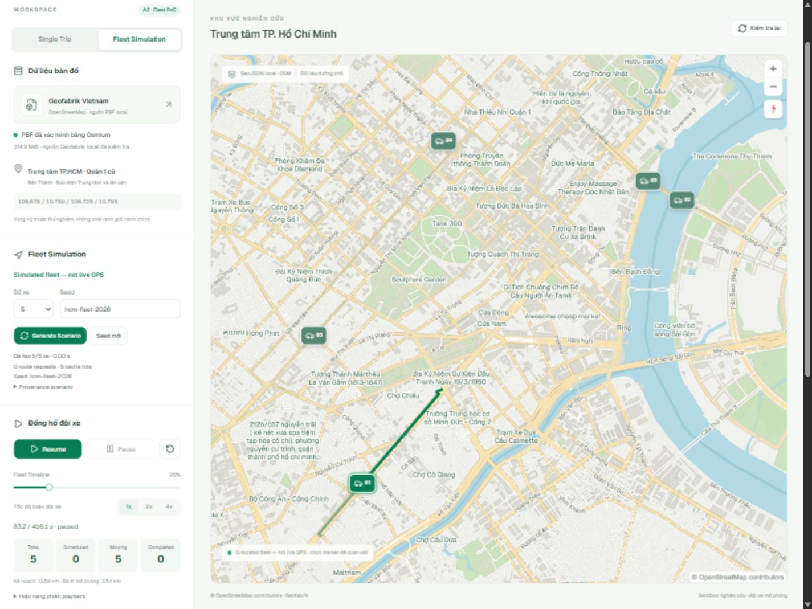
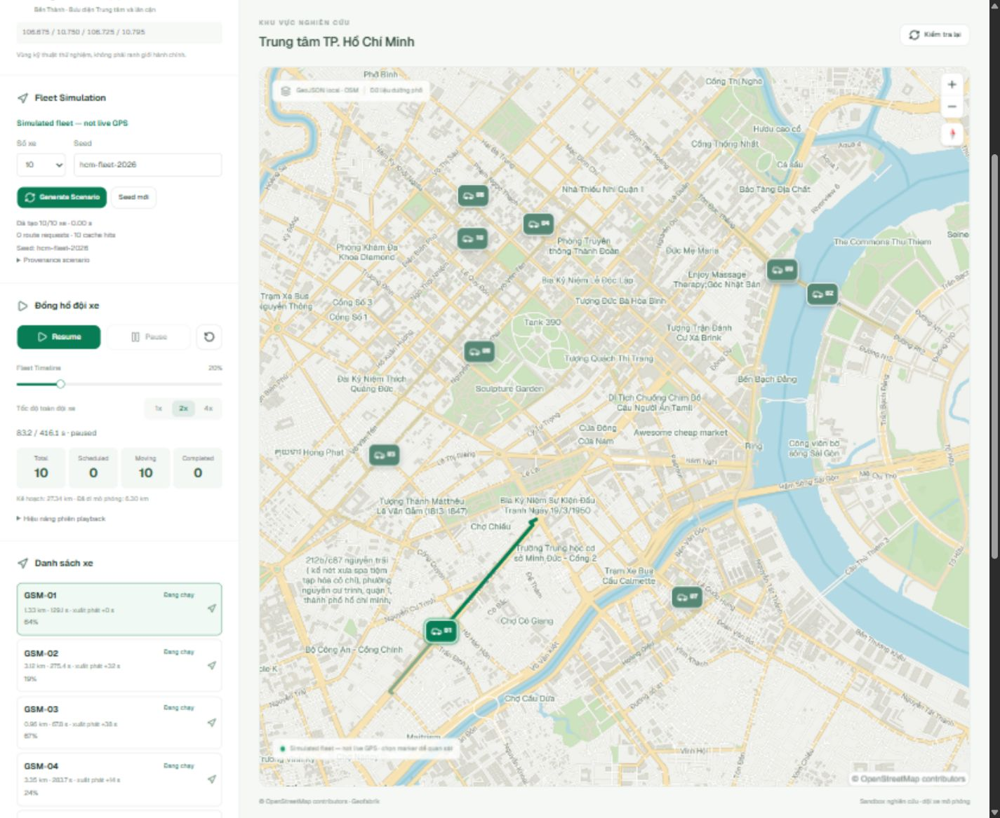

# Báo cáo A2 — Fleet Simulation & Synchronized Playback

Ngày thực thi: 2026-10-11, Asia/Saigon. Workspace: `D:\ThS\VinAI\Phase3_VRIC\gsm-map-sandbox`.

## 1. Executive Summary — GO A3 trong phạm vi PoC

**A2 hoàn tất về chức năng:** Single Trip A1 vẫn chạy; fleet mặc định 5 xe và stress scenario 10 xe được tính từ OSRM local thật. Từng xe đi theo geometry riêng, dùng một simulation clock. Play/Pause/Resume/Reset/Seek/1x/2x/4x, selection, focus và fit route đã thử trên browser WebGL desktop/mobile. Không có blocker cốt lõi còn tồn tại.

GO chỉ dành cho bước nghiên cứu tiếp theo: không chứng nhận traffic/GPS thực, toàn bộ luật rẽ, 60 FPS hoặc mọi thiết bị. Hiệu năng browser hiện tại còn giới hạn ở mục 8. **Dừng sau A2, chưa triển khai A3; không commit/push/init/reset/clean Git.**

## 2. Baseline và phạm vi bảo toàn

Đã đọc implementation A1, README, API, mapcn registry source, playback và tests trước sửa. Docker CLI/Engine **29.6.2 / Linux**; container `gsm-map-osrm` đang chạy với port `127.0.0.1:5000`. Node **24.18.0**, Python trong `.venv` đã có. Backend/frontend ban đầu đang chạy trên 8000/5173; không khởi động trùng. Backend được khởi động lại để nhận endpoint bổ sung; dev server có một lần ngừng trong QA, đã kiểm tra port trống và khởi động lại.

Baseline: 53 backend tests với `RUN_REAL_DATA=1`, 12 frontend tests và production build PASS. Lần backend đầu chưa bật opt-in có 51 PASS / 2 SKIPPED, sau đó đã bật và thực thi đủ 53. Không lấy SKIPPED làm PASS.

Giữ nguyên `POST /api/route`, guards, API response contract, `playback.ts` / `use-playback.ts`, map style, local fonts/workers và pipeline GIS/OSRM. Single Trip browser mới: click A `[106.697766,10.776585]`, B `[106.700007,10.781760]`; OSRM trả khoảng **1.35 km / 137.0 s**, snap **1.3 / 8.8 m**. Play/Pause/Seek 50%/Reset thực thi được; có đúng một single-trip marker. [Ảnh regression](evidence/a2/single-trip-regression.png), [API responses](evidence/a2/api-responses.json).

## 3. Module thêm/sửa

| Module | Nội dung |
|---|---|
| `backend/app/fleet.py` | Chọn candidate từ vertex đường OSM thật, spatial grid, provenance/fingerprint, cache đọc GeoJSON theo mtime/size |
| `backend/app/main.py` | Thêm `GET /api/fleet/candidates`, chỉ trả khi dataset/router ready; giữ route endpoint A1 |
| `frontend/src/lib/fleet.ts` | Vehicle/scenario/playback types, seeded input generation, route validation, pure position/status/overview, bounded preparation/cache |
| `frontend/src/lib/fleet-clock.ts` | Một RAF, absolute shared time, pause/seek/speed/completion/cleanup và RAF metrics |
| `frontend/src/lib/use-fleet.ts` | Scenario loading, abort/stale response guards, selection và clock subscriptions |
| `frontend/src/components/fleet-panel.tsx` | Controls, seed/count, overview, vehicle list/detail, focus/fit và lỗi từng xe |
| `frontend/src/components/fleet-map.tsx` | Một map: tuyến nền tĩnh, tuyến được chọn có RouteProgress, mapcn MapMarker của fleet |
| `frontend/src/components/runtime-audit.tsx` | Resource observer chỉ trong dev, không gửi request, không thêm timer |
| `frontend/src/App.tsx`, `App.css`, `components/sandbox-map.tsx` | Tabs Single Trip/Fleet, cleanup khi đổi mode, responsive UI; giữ single-trip MapRoute/RouteMarker |
| `frontend/tests/fleet.test.ts`, `dashboard.test.tsx`, `tests/test_a2.py` | Unit/regression/lifecycle/provenance và real-data integration |
| `frontend/scripts/audit-fleet.mjs` | Tạo 5/10 xe bằng API local thật, kiểm tra deterministic/cache/geometry distinct, lưu evidence |
| `scripts/audit_fleet_positions.py` | Đối chiếu telemetry browser độc lập với từng segment OSRM và tiến độ clock |
| `README.md`, `docs/A2-report.md`, `docs/evidence/a2/` | Hướng dẫn và bằng chứng A2 |

Không cài thêm package/library/system software; không đổi package lock. React 19, Vite 8, TypeScript, Tailwind 4, shadcn/ui, mapcn, MapLibre 6, FastAPI/Pydantic được tái sử dụng. Registry mapcn không bị sửa trong A2. API component được đối chiếu với [tài liệu routes chính thức](https://mapcn.vercel.app/docs/routes) và source đang cài.

## 4. Data model và clock architecture

Vehicle có ID/label, start/end, full route và snaps, distance/duration, departure offset; projection bổ sung scheduled/moving/completed, progress/currentPosition/heading. Scenario có seed, vehicles, total duration, createdAt, routingSource, fingerprint/provenance, requested count, failures, request/cache/preparation metrics. Playback gồm time/speed/status cùng selectedVehicleId.

`FleetClock` dùng **một RAF cho cả fleet**, lấy `anchorSimulationTime + (wallTime - anchorWallTime) × speed`. Không cộng dồn progress từng xe qua frames. State phát tối đa 30 Hz; vị trí/status tính trực tiếp từ time:

```text
progress = clamp((simulationTime - departureOffset) / OSRM duration, 0, 1)
scenario duration = max(departureOffset + duration)
```

Trước offset: scheduled; tại offset: moving; hết duration: completed. Xe có offset 0 tại time 0 là moving với progress 0, dù clock paused. Seek pause toàn scenario; Reset giữ seed/routes nhưng đưa time về 0. Tất cả completed thì RAF dừng; Play từ completed bắt đầu lại từ 0. Speed re-anchor clock để không nhảy thời gian. Unmount/cancel/regenerate/mode switch dọn RAF và request.

Clock là external store; chỉ Fleet Panel, Fleet Markers và Selected Route subscribe. App/data sidebar không rerender theo từng tick. Tuyến nền không cập nhật geometry mỗi frame; chỉ RouteProgress của tuyến chọn cập nhật. Một MapLibre canvas được đếm thật trong browser, không tạo map cho mỗi xe/frame.

Fleet position dùng cùng equirectangular segment weighting và linear segment interpolation như `RouteMarker` trong mapcn hiện cài. Geometry được đo/cached bằng WeakMap, không nội suy chord A–B. Heading dùng tangent của đoạn có độ dài dương, null nếu geometry không có đoạn đáng tin cậy. Fleet marker dùng mapcn `MapMarker` với tọa độ projection; Single Trip vẫn dùng nguyên `RouteMarker at="progress"` / `MarkerContent` / `RouteProgress` A1.

## 5. Candidate, deterministic scenario và provenance

Endpoint candidate là bổ sung nhỏ để server đọc streets GeoJSON local và trả danh sách/provenance; không gửi thêm toàn bộ GeoJSON xuống browser chỉ để chuẩn bị route. Render data không thay đổi. Candidate là vertex các way primary/secondary/tertiary/residential/unclassified; có OSM way ID, tên đường nếu có và coordinate. **Chưa coi là car-accessible trước OSRM snapping**.

Display bbox giữ `[106.675,10.750,106.725,10.795]`; routing bbox giữ `[106.660,10.735,106.740,10.810]`. Sampling bbox nằm ở 60% vùng giữa display: **`[106.685,10.759,106.715,10.786]`**, chia lưới 6×4 và nhận **24 candidate** thật. Không thu hẹp display/routing hoặc sửa graph để che dữ liệu.

Lần thử candidate phủ toàn display tạo 3/5 xe; 2 route bị từ chối `ROUTE_OUTSIDE_DISPLAY`. Đây là kết quả chuẩn bị trước điều chỉnh, không phải PASS cuối. Đưa sampling vào trung tâm để giảm route vòng ra ngoài coverage; route guard vẫn giữ, không thay geometry và không tạo fallback.

PRNG seeded + fingerprint quyết định shuffle cặp directed A/B không trùng và offsets 0–44 s. Cùng seed/count/fingerprint tạo cùng input/schedule. Fingerprint gồm extract hash, streets hash, OSRM image/profile digest, algorithm, router URL, snap threshold, bbox và candidate version. Không hứa geometry giống tuyệt đối khi dataset/profile đổi.

Fingerprint thực tế: `9193a3a34bd10f14a21da7121552503971f85419d7241aeb71bc7193eaac3341`.

Chuẩn bị tối đa **2 route requests concurrent** qua API A1; cache phiên tối đa 100 entries theo fingerprint + candidate pair. Chỉ cache route đã validate; route lỗi không sinh xe. Không retry bằng tuyến thẳng hoặc public router. Partial scenario ghi rõ số xe/lý do. AbortController và checks sau await ngăn completion cũ ghi đè scenario mới. Readiness poll 10 giây từ A1 còn hoạt động; poll có OSRM nearest probe độc lập, không phải route calculation do controls.

[Candidate catalog](evidence/a2/candidates.json), [full real fleet routes/provenance](evidence/a2/real-fleet-integration.json).

## 6. OSRM routes thật

Tái sử dụng OSRM **v5.27.1**, MLD, `car.lua`, local loopback. Image digest giữ `sha256:855614a38f464b0558a2ad6eaa7cb8c139f39887da9b38b485ce453c6e6e6124`; profile SHA-256 giữ `cb3df0546318665609606b746a1297f3d65ca3c2ff825f8a6f3c57247d86a2d3`. Không extract/preprocess lại, không ghi vào graph.

Seed `hcm-fleet-2026`:

| Xe | Distance m | Duration s | Offset s | Geometry points |
|---|---:|---:|---:|---:|
| GSM-01 | 1,330.9 | 129.1 | 0 | 59 |
| GSM-02 | 3,121.0 | 275.4 | 32 | 60 |
| GSM-03 | 961.0 | 67.8 | 38 | 39 |
| GSM-04 | 3,354.5 | 283.7 | 14 | 127 |
| GSM-05 | 4,821.3 | 384.1 | 32 | 142 |
| GSM-06 | 1,284.3 | 109.0 | 42 | 32 |
| GSM-07 | 1,963.3 | 170.9 | 33 | 75 |
| GSM-08 | 4,331.7 | 356.9 | 39 | 104 |
| GSM-09 | 4,355.1 | 384.0 | 26 | 186 |
| GSM-10 | 1,818.3 | 141.2 | 43 | 54 |

5 xe: **13,588.7 m planned**; 10 xe: **27,341.4 m**; scenario duration **416.1 s**. Cả 10 geometry khác nhau, finite WGS84, snaps trong threshold và route nằm trong display bbox. API vẫn dùng `geometries=geojson&overview=full`. Integration retry cùng seed dùng cache 5/10 hits, **0 route requests mới**, vehicles/input/offsets giống nhau.

Backend final `/api/health` HTTP 200, `/api/dataset/status` ready true, `/api/fleet/candidates` HTTP 200; `/api/route` vẫn trả contract A1. Real NoSegment được chạy lại trong regression A1. NoRoute/timeout/malformed/down-router handling dùng contract tests; không nhận mock làm chứng cứ routing thật.

## 7. Tests và browser QA

| Nhóm | Kết quả | Bằng chứng/phạm vi |
|---|---|---|
| Baseline A1 backend/frontend/build | PASS — 53 / 12 / build | Chạy trước sửa, full real-data opt-in |
| Backend final | PASS — 56 | 53 contract/unit + 3 real-data tests; giữ toàn bộ A1 |
| Frontend final | PASS — 27 | Giữ 12 A1; deterministic IDs/inputs, bounds/snaps, projection, clock, abort/race, cleanup và fleet UI |
| Typecheck + production build | PASS | `tsc -b && vite build` |
| Real fleet 5/10 | PASS | HTTP API → OSRM local; full geometry distinct, provenance/cache verified |
| Single Trip browser regression | PASS | Click A/B mới, route, Play/Pause/Seek/Reset, một marker |
| Fleet desktop WebGL 1440×1080 | PASS | 5/10 markers, shared seek/play/speed, selection, focus/fit, reset/completion, regenerate |
| Mobile 390×844 | PASS | Map + controls/list, pan, playback, selection/focus; clientWidth = scrollWidth = 375 px (15 px scrollbar) |
| Real browser positions | PASS — 50 projections | Independent segment-membership/progress audit against OSRM geometry |
| Pause/controls network | PASS | Positions/time giữ nguyên khi Pause; `/api/route` count 10 trước/sau Play/Pause/Seek/Speed |
| Stale/unmount/errors | PASS | Unit late response/cancellation; browser regenerate liên tiếp và seed mới; không xe giả khi request fail |
| PBF/graph/render integrity | PASS | 3 PBF + 37 routing/render files checksum bằng nhau |
| Console/network final QA | PASS | Final phase 0 warn/error; observed external resource URLs = 0 |
| Lint | PASS với warnings | Không error; warnings React effect reset và shadcn/mapcn export, cùng A1 ref warnings |
| Core BLOCKED / FAIL còn tồn tại | Không có | Các lỗi phát triển đã xử lý, không giả lập routing PASS |
| Exhaustive traffic/turn-rule correctness, mọi GPU | NOT VERIFIED | Giữ phạm vi/giới hạn A1, ngoài nghiệm thu PoC |

Logs local: `evidence/a2/backend-tests.log`, `frontend-tests.log`, `frontend-build.log` (bị gitignore). [Browser QA JSON](evidence/a2/browser-qa.json), [position audit](evidence/a2/position-audit.json).

Tại **83.2 s**, 5 xe đều moving, progress riêng ≈64.45%, 18.59%, 66.67%, 24.39%, 13.33%. Pause giữ nguyên tất cả coordinate/progress/transforms qua 1.2 s. Seek gần 50% (208.1 s, slider step 0.1) cho 5 xe: 2 completed / 3 moving; cho 10 xe: 5 completed / 5 moving. Seek gần cuối + Play tự completed tại 416.1 s; Reset trả time/progress 0. Chọn/focus/fit không thay clock. Pan làm marker screen transform đổi, còn coordinate khi paused không đổi.

Browser seed mới `hcm-fleet-2026-next`, regenerate liên tiếp, tạo **5/5 xe** trong **3.29 s**, 5 requests; scenario duration **267.6 s**, tổng khoảng cách ≈11.94 km. Không giữ marker/tuyến của scenario cũ. Marker có thể chồng khi xe gần nhau; danh sách cho phép chọn đúng ID.

Trong development có lỗi HMR khi thêm method mới vào class clock nhưng React giữ instance class cũ (`getMetrics is not a function`); reload đã thay instance và giải quyết. Có một lần dev server ngừng, app thể hiện trạng thái mất backend qua proxy và xóa scenario; server được khởi động lại sau kiểm tra port. Các event này giữ trong QA JSON, không xóa để tuyên bố toàn phiên không lỗi. [Console final](evidence/a2/console-final.json) chỉ tính phase cuối sau reload/stress QA, không còn warn/error.

Ảnh thật:





- [Single Trip](evidence/a2/single-trip-regression.png), [5 xe initial](evidence/a2/desktop-5-initial.png), [10 xe stress](evidence/a2/desktop-10-playing.png).
- [Mobile map](evidence/a2/mobile-10-map.png), [mobile controls](evidence/a2/mobile-controls.png), [mobile vehicle list](evidence/a2/mobile-vehicle-list.png).

## 8. Performance và bundle

| Phép đo | 5 xe | 10 xe |
|---|---:|---:|
| Node real integration, cold session cache | 4,024.7 ms / 5 route requests | 6,958.0 ms / 10 route requests |
| Browser cold scenario trong QA | 3.46 s (lần đầu khác: 1.04 s) | 6.91 s |
| Regenerate cùng seed/cache | 0 route calls qua integration | 0 route calls / 10 cache hits; UI làm tròn 0.00 s |
| Geometry duplicate trong sample | 0 | 0 |
| Actual marker count | 5 | 10 |

Browser measured clock multipliers theo wall sampling: **1.008x / 1.984x / 3.973x** khi chọn 1x/2x/4x. 5-vehicle samples có mean RAF gaps khoảng 35.5–44.2 ms. 10-vehicle sample trước tách render: **123 frames, mean 59.7 ms, max 133.3 ms**; sample sau tách: **77 frames, mean 51.6 ms, max 116.6 ms**. Đây là các mẫu ngắn tại thời điểm/geometry khác nhau, có browser/tool/GPU overhead; **không phải benchmark kiểm soát hay chứng nhận FPS**. Không suy ra cải thiện định lượng chắc chắn. Clock vẫn đúng theo wall time; những frame bị trễ được cập nhật bằng projection tuyệt đối.

Tối ưu đã thực hiện: tuyến nền tĩnh, chỉ tuyến chọn cập nhật RouteProgress, geometry measure cache, App không subscribe clock, state publication ≤30 Hz, không routing mỗi frame. Zoom/pan và controls đáp ứng trong stress QA, không duplicate/leak/crash ở phase cuối. Việc nâng độ mượt trên GPU/thiết bị đích là technical debt; không thêm animation library.

| Production asset | A1 baseline bytes | A2 bytes | Delta |
|---|---:|---:|---:|
| JS main | 1,367,078 | 1,385,804 | +18,726 (~1.37%) |
| CSS main | 133,373 | 136,163 | +2,790 |
| JS gzip theo Vite | 389.64 kB | 394.83 kB | +5.19 kB |

MapLibre vẫn chiếm phần lớn bundle, warning >500 kB tiếp tục tồn tại. [Bundle trước](evidence/a2/bundle-before.json), [sau](evidence/a2/bundle-after.json). Không tải CDN/font mới.

## 9. Local-first/resource audit

[Resource inventory](evidence/a2/network-resources.json): **externalUrls = []**. Browser fonts, worker/shared module, scripts/CSS và API đều local. Không thêm CARTO/OSM/Overpass/Mapbox/public OSRM fallback. Native map style A1 và backend local-router allowlist giữ nguyên; browser chỉ gọi API cùng origin qua proxy.

Resource observer là dev-only, không có network call/timer. Window Resource Timing không phải HAR toàn bộ worker; worker local/source URL và backend route access được kiểm tra bổ sung bằng source/API/server output. Vite HMR WebSocket loopback là công cụ dev. Readiness poll/nearest probe còn chạy độc lập; số route calls từ controls = 0. Không tắt Internet vật lý để thử offline.

## 10. Checksum và artifact integrity

| PBF | Bytes | SHA-256 trước = sau |
|---|---:|---|
| `data/raw/vietnam-latest.osm.pbf` | 330,248,138 | `2FBD2EE6B4DC151EECF04FA6823CDDF584B47423E190118B10FCE8B6115E9D8A` |
| `data/processed/hcm-q1.osm.pbf` | 1,321,521 | `48B3FD8935B55F65D1A7E4296016A62C36D704B77EE1329F2BA0BEB4F978D3DC` |
| `data/extracted/hcm-center.osm.pbf` | 3,290,221 | `3A939D15AC7B775ABA3F5A0324064CEB3D1B19AB0D176F2B10B94448C36AFDA0` |

Đối chiếu streaming file hashes; [trước](evidence/a2/integrity-before.json), [sau](evidence/a2/integrity-after.json). **37 file** trong `data/routing/` và `data/processed/render/` (gồm manifests/working PBF/graph/GeoJSON) có bytes/hash nguyên vẹn: [trước](evidence/a2/artifacts-before.json), [sau](evidence/a2/artifacts-after.json). Không re-extraction/preprocess/cleanup, không tải PBF mới.

## 11. Hạn chế và technical debt

- Mô hình uniform time-progress theo chiều dài tuyến, không acceleration, đèn giao thông, congestion, GPS GSM hay lịch khai thác thật. Traveled distance là `OSRM distance × progress` ước lượng mô phỏng, không odometer/GPS.
- Giữ 50 invalid restrictions bị OSRM loại trong A1 và mức kiểm chứng turn/connectivity theo sample A1. Không tái kiểm toán toàn graph, không tuyên bố routing chính xác tuyệt đối; boundary components vẫn có thể unreachable.
- Chỉ render trung tâm + buffer A1. Fleet reject route đi ra khỏi display bbox; một seed khác có thể tạo partial/empty scenario với lỗi rõ ràng. Không ép OSRM hoặc tự nối endpoint.
- Marker gần nhau có thể chồng; chọn qua list/focus để phân biệt. Chưa triển khai collision avoidance hoặc traffic interaction giữa xe.
- Session cache không persist; seed/fingerprint ổn định input, không chứng nhận geometry không đổi sau cập nhật dataset/profile.
- Performance numbers là browser dev trên máy hiện tại, không chứng nhận mọi thiết bị/60 FPS. Bundle size warning và React lint warnings còn được ghi nhận.
- Backend candidate đọc GeoJSON dựa mtime/size cache; source checksum/provenance được audit độc lập. Không thêm database/monitoring nền.

## 12. PowerShell khởi chạy/trải nghiệm

Không cần extraction/preprocess lại. Kiểm tra các port trước; nếu process sandbox đang chạy thì dùng trực tiếp.

```powershell
Set-Location 'D:\ThS\VinAI\Phase3_VRIC\gsm-map-sandbox'
Get-NetTCPConnection -State Listen -LocalPort 5000,8000,5173 -ErrorAction SilentlyContinue
docker info --format '{{.OSType}}'
.\.venv\Scripts\python.exe scripts\pipeline.py serve --detach
# Terminal backend:
.\.venv\Scripts\python.exe -m uvicorn backend.app.main:app --host 127.0.0.1 --port 8000
# Terminal frontend:
Set-Location 'D:\ThS\VinAI\Phase3_VRIC\gsm-map-sandbox\frontend'
npm.cmd run dev
```

Mở `http://127.0.0.1:5173`. Chọn Fleet Simulation → Generate Scenario (5 xe mặc định) → Play. Dùng Timeline/Speed/vehicle list; đổi count 10 và Generate để stress. Seed mới rồi Generate cho scenario khác; chuyển Single Trip để click A/B như A1.

Tests và real integration: xem README; audit Node cần 22.18+ (máy đã có 24.18.0). Khi Docker dừng, mở Docker Desktop/Linux Engine rồi chạy `serve --detach`; không thay WSL/BIOS/admin settings. **Không có thao tác thủ công bắt buộc hoặc blocker hệ thống còn lại tại bàn giao.**

## 13. Xác nhận phạm vi

Mọi file ghi trong task thuộc `gsm-map-sandbox`; không sửa `gms-voucher-research-demo` hoặc file ngoài project. Git chỉ được đọc với pathspec sandbox; không stage/commit/push/reset/clean/init. Không hành khách, booking, voucher, database, authentication/cloud. PBF, render và graph A1 nguyên vẹn. **GO A3 là kết luận PoC, không phải lệnh tự triển khai A3.**
