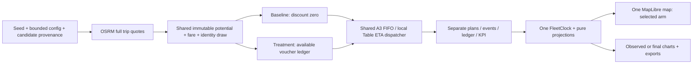

# A4 — Voucher Behavior, Budget Management & Business Comparison Studio

Ngày kiểm chứng: 12/10/2026. Workspace: `D:\ThS\VinAI\Phase3_VRIC\gsm-map-sandbox`.

## Executive Summary

**GO A5 trong phạm vi PoC nghiên cứu**, sau các kiểm chứng được mô tả dưới đây. A4 bổ sung mô hình giá/price response giả định, paired experiment, ledger theo thời gian, một clock replay, hai chart mặc định, analytics theo yêu cầu và exports. A1–A3 tiếp tục hoạt động. Không suy ra causal impact, doanh thu thực tế, profit hoặc ROI GSM từ kết quả này.

Default thực nghiệm bằng OSRM local: Baseline 13 accepted / 13 completed; Treatment 16 / 16; settled subsidy 200.000 VND; incremental completion +3; CPIC 66.666,67 VND/chuyến. Case giới hạn một xe có accepted tăng từ 13 lên 18 nhưng cả hai chỉ completed 1; Treatment chi 20.000 VND, CPIC N/A. Không ép completion tăng theo voucher.

Không triển khai A5, không commit/push/merge hoặc thay đổi branch. Không chạy extraction/preprocessing; không sửa PBF, graph, render artifacts hoặc repository GSM chính.

## A4-P0: Git, baseline và phạm vi

- Git root chính xác là project root, branch `feature/a4-voucher-comparison`.
- HEAD trước/sau: `cd0eff323f036b138b8af0e91f49a1dc84ba2e94`, trùng `main`, merge A3 PR #2. Working tree ban đầu sạch; cuối kỳ có thay đổi A4 chưa commit.
- Baseline chạy thật: **91 backend PASS, không skipped; 39 frontend PASS; typecheck/build PASS**. Các real-data tests bật `RUN_REAL_DATA=1`.
- Docker 29.6.2 Linux Engine; container `gsm-map-osrm` hoạt động; HTTP local route/Table đã kiểm chứng. Backend/frontend kiểm tra listener trước khởi động; chỉ restart backend đang phục vụ sandbox để nạp code mới.
- Bbox display `[106.675,10.750,106.725,10.795]`; routing `[106.660,10.735,106.740,10.810]`. Candidate A2 sampling bbox `[106.685,10.759,106.715,10.786]`, giữ nguyên.
- OSRM `ghcr.io/project-osrm/osrm-backend:v5.27.1`, MLD, `car.lua`. Digest `sha256:855614a38f464b0558a2ad6eaa7cb8c139f39887da9b38b485ce453c6e6e6124`; profile SHA-256 `cb3df0546318665609606b746a1297f3d65ca3c2ff825f8a6f3c57247d86a2d3`. URL `http://127.0.0.1:5000`, snap limit 100 m, hai leg liên tục trong tolerance 1 m.

## Modules và kiến trúc

| File | Thay đổi |
|---|---|
| `backend/app/voucher.py` | Config có giới hạn; fare/sigmoid/draw; ledger; paired orchestration; KPI/time series/fingerprint |
| `backend/app/booking.py` | Tách helper FIFO dispatch/deadline; optional external inputs/arrival decision/outcome callback; hỗ trợ arm không accepted |
| `backend/app/main.py` | POST `/api/voucher-experiment/prepare`; reuse local guards/client/preparation semaphore |
| `frontend/src/lib/voucher.ts` | Typed experiment, validation, pure KPI projection, delta, CSV/JSON downloads |
| `frontend/src/lib/use-voucher.ts` | Abort/stale cleanup; một FleetClock; arm switch và selection |
| `frontend/src/lib/booking.ts` | Optional validation filtered demand; mặc định A3 giữ nguyên |
| `frontend/src/components/booking-map.tsx`, `sandbox-map.tsx` | Narrow session contract để reuse BookingMap, MapRoute/RouteProgress và một map instance |
| `frontend/src/components/voucher-panel.tsx` | Config/playback/budget/xe/booking/focus |
| `frontend/src/components/voucher-dashboard.tsx` | Observed/final cards, default charts, lazy analytics, exports |
| `frontend/src/components/voucher-charts.tsx`, `voucher-analytics.tsx`, `ui/chart.tsx` | shadcn Charts + Recharts; legends/tooltips; currency/percent axes |
| `frontend/src/App.tsx`, `App.css` | Nút Studio riêng dưới divider; cleanup mode; responsive layout; chart colors |
| `frontend/package.json`, `package-lock.json` | Thêm Recharts **3.8.0**; chart component từ official shadcn registry |
| `tests/test_a4.py`, `frontend/tests/voucher.test.tsx` | Math/accounting, parity, lifecycle, validation, race/replay/UI/export tests |
| `scripts/audit_voucher.py`, `audit_voucher_browser.py` | Real API cases, plan/ledger audit, browser projection/download audit |
| `README.md`, `docs/A4-report.md`, `docs/evidence/a4/` | Cách chạy và bằng chứng có thể kiểm tra lại |

Không có routing engine/dispatch policy thứ hai. A3 `build_plan` mặc định vẫn nhận toàn bộ demand cũ; A4 dùng cùng helper, cung cấp decision callback tại arrival và ledger callback tại completed/unserved. Hai arms có trạng thái xe/hàng chờ/ledger riêng, chỉ chia sẻ read-only inputs và cache tuyến/Table trong một preparation. Requests routing tuần tự, semaphore giới hạn 2 preparations; không có async response ordering quyết định kết quả mô phỏng.



### API contract và replay

`POST /api/voucher-experiment/prepare` nhận `seed`, `fleetSize`, `potentialCount`, `horizonSeconds`, `maxWaitSeconds`, `preset`, nested `fare`, `behavior`, `voucher`, `campaignBudget`. `{}` dùng default. Extra fields bị reject; client không gửi router URL. Config tiền là integer VND; floats hữu hạn và trong miền. Default được validate/normalize để request `{}` và request gửi rõ cùng tham số có cùng canonical fingerprint inputs.

Response gồm `id`, config, `potential`, `baseline`/`treatment` (plan, decisions, ledger), `final`, `comparison`, `timeSeries`, common duration, provenance, assumptions/model versions, createdAt, preparation latency và routing counters. Existing A1/A2/A3 API contracts giữ nguyên. Lỗi config `INVALID_EXPERIMENT_CONFIG`; chưa có dataset `DATASET_NOT_READY`; router lỗi giữ structured error của local routing helpers. Invalid quote recoverable bị loại khỏi valid-potential denominator ở cả hai arms, không sinh fare/geometry thay thế.

Một clock dùng absolute simulation time và một RAF đang hoạt động. Positions dùng phép đo đoạn tuyến giống mapcn, nội suy theo chiều dài polyline OSRM; không nối thẳng pickup/dropoff. Seek dựng lại lifecycle/ledger từ plan, không mutate lịch sử. Arm switch giữ timestamp và xóa selection cũ. Regenerate, mode change, readiness mất hoặc unmount abort request, reset/dispose clock. Playback/export không gọi lại OSRM.

## Mathematical Models, Assumptions & KPI Definitions

Các default dưới đây do implementation chọn để trình diễn, **không phải bảng giá hoặc hệ số hành vi được ước lượng từ GSM**. Đơn vị tiền integer VND; OSRM distance m chuyển km trước tính fare. Timestamp/duration là simulation seconds; longitude/latitude WGS84. Các ví dụ số là ví dụ công thức, không thay thế road geometry thật.

### A. Fare Estimation Model

Mục đích: quote cùng base fare cho potential trip trước khi hai arms quyết định booking.

\[
F_i=\operatorname{RoundHalfUp}\left(F_{base}+r_{distance}\frac{d_{i,m}}{1000}\right).
\]

`F_i` integer VND ≥ 0; `d_i,m` là full car route distance OSRM hữu hạn ≥ 0 m; `F_base` default 10.000 VND, giới hạn integer 0–100.000; `r_distance` default 12.000 VND/km, giới hạn integer 0–100.000. Route API vẫn yêu cầu route metrics hợp lệ. RoundHalfUp dùng Decimal, không banker rounding: 2,5 → 3 VND. Với 2.500 m: fare = 10.000 + 12.000 × 2,5 = **40.000 VND**.

Code: `voucher.py: money, fare_quote`; test `test_currency_half_up_fare_uses_osrm_distance`. Missing/invalid road route tạo invalid potential, không dùng Euclidean distance. Mô hình chưa có VAT, traffic fee, surge, loại xe hoặc minimum trip charge riêng; fare không phải doanh thu thực tế.

### B. Logistic/Sigmoid Passenger Price Response

Mục đích: xác suất booking phụ thuộc giá thực sự được offer tại request time.

\[
F_{effective,i}=\max(0,F_i-D_i),\quad z_i=\alpha_i-\beta_i F_{effective,i}/F_{ref},\quad P_i=\sigma(z_i).
\]
\[
\sigma(z)=\begin{cases}1/(1+e^{-z})&z\ge0\\e^z/(1+e^z)&z<0.\end{cases}
\]

`alpha` là log-odds nền (không đơn vị), default 1,5, giới hạn [-20,20]; `beta` là hệ số giá chuẩn hóa, default 2, giới hạn [0,20]; `F_ref` default 50.000 VND, integer [1,1.000.000]. Tất cả hữu hạn; `D_i` integer trong [0,F_i], `P_i` trong [0,1]. A4 dùng chung alpha/beta cho tất cả passengers, mỗi potential vẫn lưu attributes để audit. Nhánh sigmoid chỉ exponent số không dương, không overflow khi |z| lớn.

Với fare 40.000 VND: Baseline z = 1,5 − 2 × 40.000/50.000 = −0,1, P ≈ **0,475021**. Discount 20.000 VND: z = 0,7, P ≈ **0,668188**. Vì \(\partial P/\partial F_{effective}=-(\beta/F_{ref})P(1-P)\le0\), giá giảm không làm giảm P khi beta ≥ 0. Beta = 0 cho P độc lập giá.

Code: `sigmoid`, `probability`; tests `test_stable_sigmoid` (±100.000), `test_monotonic_price_discount_and_reference`, `test_invalid_config`. Không có calibration, latent heterogeneity, congestion response, voucher perception hoặc customer learning. Probability tăng không đảm bảo số completed tăng.

### C. Bernoulli Booking Decision và common random numbers

Mục đích: chuyển probability thành decision deterministic theo identity, giữ draw chung giữa arms.

\[
book_i=\mathbf1[u_i<P_i],\qquad
u_i=\frac{\operatorname{uint64}(SHA256(k)_{0:8})\gg11}{2^{53}},
\]

với key UTF-8 `price-response-v1:{seed}:{datasetFingerprint}:{passengerId}`. `u` không đơn vị, trong [0,1); seed length 1–80; simulated passenger ID là stable identity, không thông tin cá nhân. Đây là deterministic pseudo-uniform hash draw, không sampling riêng từng arm và không phụ thuộc thứ tự gọi. Fare/voucher không nằm trong draw key để so policy trên cùng draw khi seed/dataset/passenger identity không đổi.

Ví dụ u = 0,6: với P_B ≈ 0,475 và P_T ≈ 0,668, passenger reject Baseline và accept Treatment. u = 0,8 reject cả hai. Equality u = P bị reject vì dùng `<`. Code `stable_draw`, callback `decide`; tests `test_draw_independent_identity_arm_and_call_order`, `test_same_seed_fair_inputs_and_no_forced_completion`, zero parity. Không có behavioral noise theo frame hoặc resampling để làm kết quả đẹp; một realization nhỏ không phải expectation/population estimate.

### D. Voucher Discount Model

Mục đích: xác định mức ưu đãi đủ điều kiện, rồi kiểm tra available budget trước tính probability.

\[
D_i^*=\begin{cases}0&F_i<F_{min}\\\min(F_i,V_{fixed})&\text{fixed}\\\operatorname{RoundHalfUp}(\min(F_i,F_i r,D_{cap}))&\text{percentage}.\end{cases}
\]
\[
D_i=\begin{cases}D_i^*&\text{Treatment và }D_i^*\le B_{available}(t_i)\\0&\text{otherwise}.\end{cases}
\]

`V_fixed` default 20.000 VND integer [0,1.000.000]; `r` default 0,3, hữu hạn [0,1]; `D_cap` default 25.000 VND integer [0,1.000.000]; `F_min` default 0 VND cùng miền; `D` không vượt fare. Baseline luôn D = 0. Một booking tối đa một voucher. Nếu không đủ full discount thì D = 0, không partial voucher, reason `BUDGET_UNAVAILABLE`.

Fare 40.000: fixed = 20.000; percentage 30% = 12.000. Fare 100.000, 30%, cap 25.000 → 25.000. Fare 15, 50% → 8 VND half-up. Fare dưới minimum → 0. Code `discount_for`, arrival `decide`; tests `test_discount_caps_minimum_and_rounding`, controls fixed0/rate0/minimum vượt fare/budget0. Chưa có campaign targeting, stacking, expiry/cancellation ngẫu nhiên; eligibility chỉ min fare và budget.

### E. Voucher Budget Accounting

Mục đích: giữ ngân sách đúng với decision/outcome theo thời gian mô phỏng.

\[
B_{available}(t)=B_{total}-B_{reserved}(t)-B_{spent}(t),\quad
B_{reserved},B_{spent},B_{available}\ge0.
\]

`B_total` default 200.000 VND, integer [0,10.000.000]. Reserved là tổng reservation chưa terminal; spent chỉ tổng SETTLED. OFFERED không đổi tiền; accepted voucher giữ chỗ đúng D; completion chuyển reserved → spent; unserved xóa reservation/hoàn available. Event ghi stable ledger ID, booking ID, timestamp, amount và snapshot bốn balances. SETTLED/RELEASED terminal một lần; không negative/over-budget.

Ví dụ budget 40.000: reserve B1/B2 mỗi 20.000 → reserved40k, spent0, available0. B2 unserved → reserved20k, available20k. Request mới B3 có thể reserve20k; completion B1 → reserved20k, spent20k, available0. Booking đã quyết định full fare trước release không được nâng cấp hồi tố.

Thứ tự A4 tại cùng timestamp: hoàn tất/settle, cập nhật vị trí xe; pickup events; thử FIFO cho queue có sẵn với deadline inclusive; expire queue chưa thể pickup và release; potential mới theo (time,ID), offer/decision/reserve; FIFO dispatch; expire còn lại. Thus released budget có thể dùng cho arrival cùng timestamp **sau** release trong deterministic ordering. A3 default ordering và policy vẫn giữ nguyên khi không có callbacks. Ledger có thứ tự chronology riêng; lifecycle log sort theo `EVENT_ORDER` cũ, không dùng thứ tự sort log để suy ra offer trước/sau.

Code `BudgetLedger`, `observe`, shared `build_plan`; tests `test_ledger_offered_reserve_settle_release_once`, `test_rejected_offer_does_not_reserve`, `test_release_before_same_time_arrival_settlement_and_no_retroactive_discount`. Real capacity case: reserved18 vouchers, released17, settled1; cuối reserved0/spent20k/available980k. Không hoàn tiền sau completed, không accounting cashflow/fees ngoài subsidy này.

### F. Fleet Dispatch Model

Mục đích: chọn xe idle có ETA OSRM nhỏ nhất cho booking FIFO, không thay policy vì voucher.

\[
v^*=\arg\min_{v\in I(t),\ ETA_v\ne null,\ t+ETA_v\le t_i+W_{max}}(ETA_v,vehicleID_v).
\]

`I(t)` là xe idle, `ETA_v` là OSRM Table duration giây từ vị trí xe hiện tại đến snapped pickup; `t_i` request time, `t` thời điểm thử dispatch, `W_max` default 300 s, integer [10,900]. Fleet default5, integer[1,10]. Tie deterministic vehicle ID. Null/unreachable Table không eligible. Sau ranking, full pickup route xác nhận continuity/snapping và **actual full-route duration** phải pickup trước deadline. Nếu candidate route lỗi/too late, thử candidate tiếp; không assign sai. Xe đang ở pickup (<0,1 m) có pickupRoute=null và duration0, không tạo road route giả. Idle sau completion ở snapped dropoff.

Ví dụ request t_i=100, dispatch t=130, W=300; idle ETAs GSM-01=100, GSM-02=70 → chọn GSM-02, pickup dự kiến200 (wait100). Full route duration khác Table được dùng cho event schedule. ETA300 tại t130 không đạt deadline400. Code `booking.py: dispatch_pending`, `LocalTravel.table/route`; A3 tests minimum ETA/tie/busy/null/continuity/deadline và real plan validation được giữ; A4 regression chạy toàn bộ. FIFO không tối ưu toàn cục, OSRM estimate không live traffic, không dwell/acceleration/congestion.

### G. Operational KPIs và geometry projection

Mục đích: mô tả hoạt động từng arm tại t, không trộn final với current.

Đặt `V(t)` số valid potentials đã arrival, `A(t)` accepted, `G(t)` đã assigned, `P(t)` đã pickup, `C(t)` completed, `U(t)` unserved. Tất cả là count 0–30, event timestamp ≤ t. Các tỷ lệ:

\[
Conversion(t)=A(t)/V(t),\qquad Completion(t)=C(t)/A(t).
\]

Mẫu số 0 → null/N/A. Ví dụ default final: Baseline13/30=43,33% conversion,13/13=100% completion; Treatment16/30=53,33%,16/16=100%. Capacity Treatment completion1/18=5,56%, không phải1/30. Invalid quote không vào V.

\[
MeanWait(t)=\frac{\sum_{i\in P(t)}(pickup_i-request_i)}{|P(t)|},\quad
MeanTrip(t)=\frac{\sum_{i\in C(t)}duration^{trip}_i}{|C(t)|}.
\]

MeanWait/MeanTrip đơn vị s, null nếu mẫu rỗng; mean ETA chỉ assigned, full pickup duration. Ví dụ waits60/120 s →90 s; không đưa unserved vào mean. Default final Treatment MeanWait142,706125 s, MeanTrip211,56875 s. Quote fare distance và trip duration là OSRM estimate, wait là mô phỏng queue + pickup.

\[
Utilization(t)=\frac{\sum_i\max(0,\min(t,dropoff_i)-assigned_i)}{N_{fleet}t},\quad t>0.
\]

Busy gồm pickup+occupied; tỷ lệ [0,1], t0 → null. Ví dụ 5 xe, t100 s, tổng busy200s →40%. Default final dùng common2115,191s: Baseline40,82%, Treatment52,75%. Không dùng arm kết thúc sớm làm denominator nhỏ hơn.

Với mỗi leg duration T>0, start s, distance d m: \(p(t)=clamp((t-s)/T,0,1)\), travelled distance = d×p. Tổng pickup legs là empty; tổng passenger legs là occupied. Geometry position tìm target p×tổng độ dài các đoạn OSRM (equirectangular cùng mapcn), nội suy chỉ trong đoạn chứa target, bỏ đoạn dài0. Ví dụ 2.000 m, duration200 s, elapsed50 →500 m đã đi; xe nằm trên polyline ở25%, không đường thẳng endpoints. Default final Treatment empty24.433,4 m/occupied39.421,5 m.

Code backend `arm_metrics`, frontend `experimentMetrics`, A3 `bookingProjection`, A2 `fleetPosition`; tests `test_observed_financial_identity_seek_and_denominators`, frontend cross-check mọi stored timeSeries, backward Seek/final fractional timestamp, independent browser position audit. Di chuyển đều theo distance/time, không tốc độ từng segment, GPS hoặc traffic; utilization là busy-time ratio tích lũy, line chart là các samples nối tuyến tính, không đo instantaneous occupancy.

### H. Financial & Incremental KPIs

Mục đích: đối soát fare/subsidy và so hai arms; chỉ tiền completed trips.

\[
GFV(t)=\sum_{i\in C(t)}F_i,\quad Spend(t)=\sum_{i\in C(t)}D_{settled,i},\quad
Payments(t)=\sum_{i\in C(t)}(F_i-D_{settled,i}).
\]
\[
GFV=Payments+Spend,\quad Uplift=A_T-A_B,\quad Increment=C_T-C_B,
\]
\[
CPIC=\begin{cases}Spend_T/Increment&Increment>0\\null&Increment\le0.\end{cases}
\]

GFV/Payments/Spend là integer VND ≥0; uplift/increment là signed counts; CPIC VND/completed trip, có thể fractional; UI làm tròn hiển thị, JSON/CSV giữ ratio chưa round. Reserved/offered/released không là spend. VND display dùng `Intl.NumberFormat('vi-VN')`.

Default final Treatment: 633.058 = 433.058 + 200.000 VND. Baseline GFV/payments464.928. Uplift16−13=3; Increment16−13=3; CPIC200.000/3=66.666,67 VND/chuyến. Capacity: Spend20.000 nhưng increment1−1=0 →N/A. Negative increment cũng null, test trực tiếp; không có real negative-increment case trong bộ seeds này.

Code `arm_metrics`, `comparison`, frontend `experimentMetrics`, `delta`, `vnd`; backend financial identity test; frontend denominator/null/negative test; browser CSV audit; real no-increment experiment chi458.988 VND nhưng completion23/23. Toàn bộ fare/voucher là giả định trợ giá toàn phần; GFV không phải profit/GSM realized revenue. Không CAC/LTV/margin/ROI vì thiếu chi phí và dữ liệu customer.

### I. Paired Experiment Methodology

Mục đích: kiểm soát input differences để so policy trong mô hình, chuẩn bị nền cho nghiên cứu tiếp theo.

\[
Y_B=f(X,u,vehicles_0,graph,dispatch,D=0),\quad
Y_T=f(X,u,vehicles_0,graph,dispatch,D=policy(ledger,t)).
\]

`X` là potential inputs immutable (ID/passenger/request/pickup/dropoff/base fare/attributes/candidate provenance), `u` common draws; hai arms cùng initial fleet, graph/profile, FIFO policy, max wait và arrival horizon. Preset Low trải đều+jitter, Medium uniform theo seeded generator, High dồn vào¼ đầu horizon; count không đổi. Default seed `hcm-voucher-2026`,30potentials,5xe,horizon1800s; countinteger[10,30], horizoninteger[60,3600]. Booking demand chỉ là accepted subset, outcomes độc lập mỗi arm.

\[
T_{common}=\max(H,T_B,T_T),\qquad ID=SHA256(canonicalJSON(config,potential,datasetFingerprint,versions)).
\]

Arrival horizon H đóng nhu cầu mới; plan drain accepted đến terminal, cả hai báo final cùng T_common. Default ends2115,191s >1800s, công bố rõ thay vì cắt chuyến đang chạy. Fingerprint loại createdAt/preparation latency/counters, nhưng bao gồm quoted route/dataset/model config. Default and explicit config normalize trước hashing. Repeat real scenario: potential, decisions, ledger, assignments/events, final/timeSeries/id giống; metadata thời gian được phép khác. Zero voucher giữ semantic plans và metrics giống (Treatment vẫn có configured budget, vì thế budget total/available khác Baseline là có chủ đích).

Code `demand_inputs`, `prepare_experiment`, identity hashing; tests default canonical config, common input parity, real repeat/zero; frontend arm switch/Seek/cancellation. Ví dụ cùng u0,6 dẫn decision khác chỉ khi discount thực sự available; budget0 cả hai P0,475 nên reject. Common random numbers giảm nhiễu so sánh nhưng không làm kết quả thành bằng chứng nhân quả, thống kê đã hiệu chỉnh hoặc dự báo kinh doanh. Geometry không được hứa giữ nguyên nếu dataset/profile/version thay đổi.

## Real integration và nghiệm thu

Nguồn bằng chứng: `docs/evidence/a4/integration-summary.json` và full JSON từng case, do `scripts/audit_voucher.py` gọi FastAPI thật → local OSRM. Mỗi plan được validate geometry/bounds/route metrics/lifecycle, ledger chronology/balances/terminal outcomes, acceptance probability, financial identity và same fleet. Mock fixtures trong unit tests chỉ dùng cho math/edge events, không coi là routing proof.

| Case | Baseline accepted/completed/unserved | Treatment accepted/completed/unserved | Settled VND | Increment | CPIC VND |
|---|---|---|---:|---:|---:|
| Default fixed | 13/13/0 | 16/16/0 | 200.000 | 3 | 66.666,67 |
| Repeat | 13/13/0 | 16/16/0 | 200.000 | 3 | 66.666,67 |
| Percentage30%, cap25k | 13/13/0 | 17/16/1 | 193.191 | 3 | 64.397 |
| Zero fixed0 | 13/13/0 | 13/13/0 | 0 | 0 | N/A |
| Budget20k exhaustion | 13/13/0 | 14/14/0 | 20.000 | 1 | 20.000 |
| Capacity1xe/High/60s/wait60 | 13/1/12 | 18/1/17 | 20.000 | 0 | N/A |
| Alpha20/beta0/no incremental | 30/23/7 | 30/23/7 | 458.988 | 0 | N/A |
| Stress10xe/30potentials | 13/13/0 | 16/16/0 | 200.000 | 3 | 66.666,67 |

Default preparation routing counters: nearest10, Table29, route51, route-cache hits35, table-cache hits1. Không tính quote là booking hoặc route request trong playback. Case API chuẩn bị lại sau sửa canonical fingerprint; counters/semantic outcomes không đổi. Thời gian đo lần chạy mới nằm trong integration-summary, không dùng thời gian lịch sử như SLA.

### Charts và UI

Three tabs A1–A3 giữ nguyên; Studio là button riêng dưới divider, active riêng. Một MapLibre canvas; chọn/focus booking hoặc xe, active route mapcn, map dùng local street/water/park/building/labels đã kiểm chứng và OSM attribution.

Hai chart mặc định: grouped horizontal conversion funnel (valid/accepted/assigned/picked/completed) và cumulative completed step-line. Advanced lazy mount chỉ sau click: cumulative accepted step-line; GFV grouped bar; payments/subsidy stacked bar; treatment budget reserved/spent/available stacked bar; spend step-line; utilization line fixed0–100%; average wait comparison bar; incremental efficiency KPI tile. Baseline xanh dương, Treatment xanh lá; reserved vàng. Các series theo observed tới t hoặc final common duration, label rõ scope. KPI/cards/chart cập nhật theo giây khi playing; pause/Seek/completed dùng timestamp chính xác. Vị trí xe projection30Hz; chart memoized và CSV memoized theo immutable experiment.

Nguồn chart implementation: [shadcn Charts](https://ui.shadcn.com/docs/components/chart), [bar examples](https://ui.shadcn.com/charts/bar), [line examples](https://ui.shadcn.com/charts/line). Chỉ thêm Recharts3.8.0 và shadcn wrapper, không chart/animation library khác.

### Browser QA và exports

Desktop1440×1080, mobile390×844, browser WebGL thật. Bằng chứng `browser-qa.json`, `browser-audit.json`, screenshots trong evidence/a4. Manual actions: chuẩn bị plans mới; A1clickA/B+play/pause; A2generate5+play/pause; A3generate5/20+seek/play/pause/reset/focus. A4 kiểm tra default/stress/capacity, Baseline/Treatment same500s, Play/Pause/Resume2x/4x, stable pause, Reset0, backwards Seek, fractional completed2115,191s, observed/final scope, default2charts, advanced10sections mở/đóng, percent axis, GFV tooltip/legend/VND, selection/focus, seed/regenerate và latest request thắng. Mobile các chế độ/control/chart dùng được, document scrollWidth bằng clientWidth375px (390px viewport trừ scrollbar), không overflow.

Download thật qua buttons: `browser-export.json`, `browser-summary.csv`, `browser-decisions.csv`, `browser-bookings.csv`, `browser-ledger.csv`, `browser-series.csv`. CSV UTF-8 BOM, CRLF, RFC4180 quotes, stable IDs, unit suffixes; neutralize formula prefixes cho strings. Audit so JSON full plan với API capture, CSV rows/metrics/decision/assignment/ledger/series với plan. Export dùng final/full history, không đổi clock hoặc kết quả; không upload/cloud. Data là simulated passengers và public OSM geography, không dữ liệu cá nhân thật.

Desktop screenshots: `desktop-map-default.jpg`, `desktop-default-charts.jpg`, `desktop-advanced-top.jpg`, `desktop-currency-tooltip.jpg`, `desktop-ten-vehicles.jpg`, `desktop-capacity-no-increment.jpg`, `desktop-regression-a1/a2/a3.jpg`. Mobile: `mobile-a4-map.jpg`, `mobile-a4-default-charts.jpg`, `mobile-a4-analytics.jpg`, `mobile-regression-a1/a3.jpg`. Audit cuối khớp **224 vehicle projections / 42 KPI snapshots**, max coordinate error **1,432×10⁻¹⁴ degrees**; dùng full route projection độc lập bằng Python, status/progress, one canvas và backend/frontend KPI tại cùng timestamp. CSV rows: summary39, decisions60, bookings29, ledger35, series232. Screenshot chỉ là minh họa, không thay phép audit dữ liệu.

### Bảng tests

| Nhóm | Kết quả | Bằng chứng |
|---|---|---|
| Baseline A3 backend/frontend | PASS91/39, không skipped | Preflight execution |
| Backend cuối A4 (real-data opt-in) | PASS127, không skipped | `backend-tests.log` |
| Frontend regression + A4 | PASS53 | `frontend-tests.log` |
| Typecheck/production build | PASS | Vite build, TypeScript |
| Lint | PASS exit0, warnings còn | 11 warnings, chủ yếu hooks/Fast Refresh; không sửa technical debt ngoài scope |
| Real OSRM8cases/repeat/parity/budget | PASS | `integration-summary.json` |
| Browser A1/A2/A3 desktop/mobile | PASS | Regression snapshots/screenshots |
| A4 controls/arms/advanced/capacity/stress/mobile | PASS | `browser-qa.json` |
| Browser projection/KPI/download audit | PASS | `browser-audit.json` |
| Geographic artifact integrity | PASS40/40 | `integrity-before.json`, `integrity-after.json` |
| Calibrated customer behavior/causal business effect | NOT IN SCOPE | Không có observed customer dataset |

Không có FAIL/BLOCKED chức năng cốt lõi còn lại. Trong QA đã sửa axis utilization autoscale thành0–100%, memo hóa chart/CSV, bảo đảm fractional completed timestamp không mất final event, chuẩn hóa fingerprint default. Một test đầu tiên dùng exact float equality thất bại do sai khác1e-16; sửa assertion thành tolerance12digits, giữ checks tiền/event exact. Một browser-control CDP timeout khi analytics mở được phục hồi bằng reload/rebind và kiểm tra lại thao tác thành công; không giấu lần lỗi đó hay coi attempted click là PASS. Hai telemetry snapshots dùng nhầm selector marker được gắn invalid và bỏ khỏi position audit.

### Performance, bundle và local resource audit

Baseline A3 main JS1407,79kB (gzip399,64), CSS138,08/21,95kB. A4 main1428,49/405,20kB; lazy dashboard/charts374,39/110,08kB; lazy analytics4,26/1,50kB; CSS144,69/23,24kB. Charts chỉ tải khi mở Studio, advanced view chỉ mount/tải khi yêu cầu. Vite large-main-chunk warning có từ nền MapLibre, chưa làm rewrite ngoài phạm vi.

Real preparation lần cuối: default3,034s; repeat3,855s; percentage3,277s; zero2,039s; exhaustion5,891s; capacity2,475s; no-increment3,422s; stress2,937s. Audit chạy đồng thời với browser QA nên đây là latency môi trường thực, không SLA. JSON default412.469bytes/stress380.605bytes quaHTTP. 10xe browser:982RAF samples, mean23,37ms, maxgap116,8ms; không chứng nhận60FPS. Desktop5xe/analytics có sample mean30,71ms, maxgap600ms khi load/QA; mobile5xe360samples mean33,32ms/max200ms. Absolute clock tránh tích lũy trễ; có thể stutter lúc tải chunk hoặc tooling/scroll. UI đã kiểm tra Pause/Seek/selection/pan/zoom, không crash/blocking sau sửa.

ResourceTiming observer hiện có ghi local styles/GeoJSON/glyph fonts/worker/modules/backend; audit kiểm tra không có external resource URL. Console warn/error collection rỗng trong các phiên QA cuối; export Blob URLs local. Code local router allowlist và loopback bind giữ nguyên. Setup npm registry/download chart/image Docker khác với browser map/routing runtime. Link Geofabrik attribution không được click và không là runtime map dependency. Không claim đã kiểm thử mất Internet vật lý hoặc kiểm toán mọi packet OS.

Đo shared clock qua hai DOM snapshots: 2x đi24,5664simulation seconds trong12,303wall seconds (ratio1,9968); 4x đi52,7984trong13,216s (ratio3,9950). Sai lệch nhỏ do latency lấy snapshot, không phải benchmark FPS. Pause giữ nguyên589,074s giữa hai samples; Reset về0; arm switch tại500s giữ nguyên timestamp. Các route/prepare resource counters không tăng trong chuỗi playback/arm/analytics/export trước lần Generate tiếp theo.

## Data integrity

| Artifact | Bytes | SHA-256 trước = sau |
|---|---:|---|
| `data/raw/vietnam-latest.osm.pbf` | 330.248.138 | `2FBD2EE6B4DC151EECF04FA6823CDDF584B47423E190118B10FCE8B6115E9D8A` |
| `data/processed/hcm-q1.osm.pbf` | 1.321.521 | `48B3FD8935B55F65D1A7E4296016A62C36D704B77EE1329F2BA0BEB4F978D3DC` |
| `data/extracted/hcm-center.osm.pbf` | 3.290.221 | `3A939D15AC7B775ABA3F5A0324064CEB3D1B19AB0D176F2B10B94448C36AFDA0` |

Inventory40file gồm3PBF và37routing/render entries (có.gitkeep), đối chiếu size/SHA-256 từng file. Tests tạo temporary fixtures trong subtree test-output riêng bị Git ignore; không overwrite render/graph. Không chạy Osmium/OSRM preprocessing, không tải Geofabrik, không chỉnh source địa lý, không động repository `gms-voucher-research-demo`. `git diff --check` không lỗi whitespace; CRLF portability warning là thông báo Git, không dữ liệu GIS thay đổi.

## Hạn chế và bước tiếp theo

Mẫu30potentials là PoC nhỏ, homogeneous alpha/beta chưa calibrated; seed-specific outcomes không phải treatment effect ngoài đời. Voucher có thể tăng accepted nhưng làm queue/capacity xấu đi; subsidy có thể không tăng completion. Giữ hạn chế A1:50invalid restrictions bị OSRM loại lúc preprocess lịch sử, chỉ kiểm chứng mẫu road/turns, boundary nodes có thể unreachable; không kiểm toán lại toàn graph trong A4. Duration/profile routing không live traffic; no passenger cancellation, multi-passenger/pooling, fare commission, taxation, operating cost hoặc driver earnings. Candidate footprint giới hạn trung tâm TP.HCM, không fullcity. Xe idle có thể cùng candidate và marker chồng nhau; dùng vehicle list để chọn/focus từng ID. Không tự đổi initial-fleet generator A3 để che hiện tượng này.

Phạm vi **đề xuất A5, chưa thực hiện**: lặp nhiều seeds trên cùng potential/draw identity; sensitivity grid alpha/beta/budget/capacity; báo phân phối paired outcomes/uncertainty theo mô hình; versioned saved experiment schema và replay imports có validation. Muốn business inference cần nguồn customer/price response calibration và kế hoạch đánh giá riêng, không đổi tên simulated results thành observed effect.

## PowerShell để chạy/trình diễn

Đã có artifacts: không chạy extract/display/routing. Kiểm tra listener để tránh trùng process.

```powershell
Set-Location 'D:\ThS\VinAI\Phase3_VRIC\gsm-map-sandbox'
docker ps --filter name=gsm-map-osrm
Get-NetTCPConnection -State Listen -LocalPort 5000,8000,5173 -ErrorAction SilentlyContinue
# Nếu container tồn tại nhưng đang stopped:
docker start gsm-map-osrm
# Terminal backend khi port8000 trống:
.\.venv\Scripts\python.exe -m uvicorn backend.app.main:app --host 127.0.0.1 --port 8000 --reload --reload-dir backend
# Terminal frontend:
Set-Location 'D:\ThS\VinAI\Phase3_VRIC\gsm-map-sandbox\frontend'
npm.cmd ci
npm.cmd run dev
```

Mở `http://127.0.0.1:5173` → Studio → Prepare mặc định → Seek500s/chọn booking → đổi arms cùng timestamp → Play/Pause2x/4x → Planned/Final → mở analytics/tooltip → ExportJSON/CSV. Thử capacity như bảng để thấy released/unserved/N/A. Backend docs tại `http://127.0.0.1:8000/docs`. Nếu thiếu dependencies: xem README cài .venv/npm; Docker Desktop Linux Engine cần người dùng mở, không đổi WSL/adminsettings tự động.

Không còn thao tác hệ thống bắt buộc để nghiệm thu A4 trong môi trường hiện tại. Báo cáo và code còn uncommitted trên branch A4; người dùng tự review/commit/merge nếu muốn.
