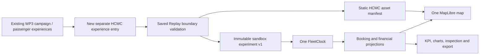

# A5 integration handoff — HCMC Mobility & Voucher Experiment

## 1. Executive summary

A5 prepares a portable Saved Replay, not an integration into GSM. Reuse the sandbox as a separate HCMC PoC experience. Do not replace WP3's existing campaign, passenger engine, NYC/Cairo evidence or money/randomness policies with the sandbox logistic assumptions. Saved runtime requires a static frontend and validated assets, no Python, Docker, FastAPI or OSRM service.

## 2. Source actually audited

Read-only audit on 2026-10-12: `D:\ThS\VinAI\Phase3_VRIC\gms-voucher-research-demo`, branch `feature/wp3-voucher-behavior-comparison`, HEAD `6a9db14620299300d23791b6351f0e52c82afc45`. This verifies that checkout, **not target main or a deployed release**. No checkout, edits, staging, build, commit or push in that repository. Historical test counts quoted in its documentation were not rerun by A5.

## 3. Verified WP3 architecture

`p06-ai-product-demo/src/main.tsx` routes `/voucher` into `proposal-demo/index.tsx`; its default is `ride-hailing-demo/index.tsx`. WP3 currently switches `campaign`/`passenger`. `ride-hailing-demo/campaign-studio.tsx` preserves CPU/browser Python/SimPy experiments and factual replay, exports `wp3-campaign-export/v1` with geometry reference. The README distinguishes NYC transport, Cairo discount evidence and assumptions. `simulation-lab/simpy.worker.ts` loads same-origin Pyodide and vendored SimPy 4.1.2; the optional archive lives at `/voucher?engine=simpy`.

There is already a separate HCM passenger product: `passenger-comparison/product-controller.ts` loads a sealed HCM catalog, prepares inputs, runs Python stdlib through a disposable Pyodide worker (`runner.ts`), validates v2 producer output and publishes an immutable session. Cancellation uses generation + AbortController. `region-loader.ts` pins bundle digest `1f482ed53a62469eaad6a56e6a65f633c804b73c835736b906621b35f52ef808`. Its `wp3-region-bundle/v1` route catalog supports a fixed endpoint set, including unavailable-route reasons. Its UI currently renders road polylines using SVG (`ui/passenger-comparison.tsx`); this is distinct from sandbox MapLibre rendering and is not proof of a sandbox basemap integration.

`passenger-comparison/contracts.ts` uses `wp3-passenger-comparison/v1`, world-scoped IDs, VND integer half-up, seconds, typed route failure states and keyed SHA random draws. The sandbox uses different IDs, a different paired random key/model and continuous geometry projection. These schemas are **not wire compatible**.

## 4. Proposed integration

Initial A6 candidate: separate same-origin static subdirectory/route, lazy loaded from WP3. An iframe can isolate CSS/dependencies for a first reviewable integration; an embedded React component needs the CSS/dependency work below. Do not reuse the existing passenger-result validator for sandbox v1 or silently adapt USD cents to VND.

## 5. Reusable sandbox modules

See `contracts/a5-handoff-package.json`. Core: `artifact.ts`, `replay-assets.ts`, `voucher.ts`, `booking.ts`, `fleet.ts`, `fleet-clock.ts`, `simulation-speed.ts`. Rendering: `map-style.ts`, installed local mapcn `components/ui/map.tsx`, `sandbox-map.tsx`, `booking-map.tsx`. UI: voucher inspector/dashboard/charts/analytics, comparison table, dock and chart viewport. `use-voucher.ts` owns asynchronous imports; the clock owns playback, pure projections own history. Keep A5 validators/tests alongside their consumers.

## 6. Keep separate

Do not move raw/extracted PBF, routing graph, GIS scripts, FastAPI, test caches, logs, development `.env` or full national OSM into WP3's public runtime. Do not change target WP1/WP2 models, NYC fare currency, Cairo observations, SimPy/Python engine, existing passenger contracts, region bundle seals, or assumption provenance. HCMC voucher results are simulated, not observed Green SM policy effects.

## 7. Contract and compatibility

Authoritative typed boundary: `frontend/src/lib/artifact.ts`. Schema `gsm-voucher-experiment/v1` wraps the complete A4 payload, model versions, timestamps, fingerprint, fixed manifest reference and integrity. Legacy A4 JSON/CSV exports remain; unwrapped A4 JSON is intentionally **not accepted by Saved import**. Convert it explicitly with `package-replay.mjs --source=...`. Unknown schema/model versions fail closed. Current models: fare-v1 / price-response-v1 / ledger-v1 / paired-v1 / dispatch-v1; routing car/MLD.

Coordinates WGS84 `[longitude,latitude]`; lengths metres, durations/event times seconds, money integer VND. Booking events/lifecycle and vehicle/assignment references use `booking.ts`; ledger OFFERED/RESERVED/SETTLED/RELEASED and financial KPI definitions use `voucher.ts`. GFV = rider payments + settled voucher; reserved/offered are not spend. Common observation horizon is max of configured intake and both drained plans. Switching arm preserves timestamp, seeking reconstructs history without HTTP or mutable carryover.

## 8. Static package

`npm.cmd run package:replay` packages only five validated A1 render layers, local Geist map fonts, MapLibre worker/shared modules, manifest and actual A4 sample. It never extracts OSM or calls routing. Generated `frontend/public/replay/` is ignored. Two small manifests under `contracts/` are tracked contract inputs. Package must be generated/copied before building a deployment; a repository checkout alone does not include ignored map files. Review generated asset licensing/size before any future data commit.

## 9. Dependencies and CSS

Audited target package declares React 19.1, Vite 7.1, TS 5.9, Phosphor icons, PapaParse, Pyodide; it has no Tailwind/mapcn/MapLibre/Recharts dependency. Sandbox uses React 19.2, Vite 8.3, TS 6.0, Tailwind 4.3, MapLibre 6.13, Recharts 3.8, Lucide and Base UI. React major version aligns; **combined build compatibility is unverified**. Keep target lockfile unchanged in A5. For React integration, agree on versions and typecheck the combined tree in A6. Sandbox global `App.css`, Tailwind preflight, font imports and CSS tokens must be scoped to a HCMC root or isolated iframe; do not paste global body rules over WP3. Reuse vendored mapcn components, do not guess registry props.

## 10. Component integration strategy

Mount one Saved session owner and one MapLibre instance. Do not paste the whole App shell into the current WP3 shell without removing duplicate navigation. Map render should survive inspector/analytics toggles. On experience unmount: abort import/assets requests, cancel batch, dispose clock subscriptions/RAF and let mapcn remove its map. Import replacement validates completely before publication; invalid import retains prior verified session with error. Clear stale booking/vehicle selections after valid replacement.

## 11. Saved flow

Open with `?runtime=saved`, select file or Load Saved Demo → size/JSON/hash/semantic checks → same-origin fixed asset manifest/hash checks → commit payload + assets → configure one clock at zero → play or seek. Map sources are in-memory validated GeoJSON. No dataset/health polling and no readiness dependency on backend. Artifact cannot supply asset URLs, stylesheet, script or router URL to execute.

## 12. Optional Live flow

Keep Live explicit and local-development only initially. Existing FastAPI prepare/route endpoints enforce local OSRM; batch uses sequential bounded calls and cancel. A static hosted WP3 should not expose or expect viewer loopback services. Do not add public OSRM fallback. A6 needs a separately authorized service design before offering remotely hosted Live preparation.

## 13. Build/deploy

Audited `deployment/vercel-static.json` rewrites existing `/voucher`, `/research`, `/slides`, `/voucher-classic`. `scripts/prepare-vercel-release.mjs` copies built `dist` into `.vercel-release`, preserving project link and excluding secrets/large files. No HCMC rewrite exists yet. A6 must add it intentionally if needed, include generated replay files, build with correct Vite `base`, and test direct refresh/deep links. A5 worker/style/static URLs use `import.meta.env.BASE_URL`; non-root hosting remains an A6 acceptance check, not a claimed deployment. Require HTTPS for WebCrypto remotely; loopback works for A5. Verify CSP worker-src self/blob, connect-src self, local fonts; no CDN requirement.

## 14. Sources/licenses

Geofabrik Vietnam derived from OSM; attribution `© OpenStreetMap contributors`, ODbL 1.0 with copyright link in manifest. Keep source/provenance/checksums and attribution visible. Retain package license notices for mapcn/MapLibre/Geist and other dependencies in any distribution; audit actual license files before A6 publishing. Sample demand/prices/behavior are synthetic assumptions on real roads, no real passenger personal data or GSM GPS.

## 15. Security and integrity

SHA-256 covers canonical sorted-key UTF-8 JSON, excludes only integrity block; arrays retain order, ECMAScript serialization, no terminal LF. One TS implementation is bundled for Node packaging. Formatting/CRLF do not change parsed-content hash. This detects accidental alteration, **not trusted authorship**: someone can recompute a digest. Compare sample to a reviewed independent manifest if authenticity matters. Map manifest content ID uses same canonicalizer; asset file hashes use raw bytes. Do not substitute target region-loader's newline hash convention.

Bounds: 12 MiB import, depth 32, 1M traversed nodes, 30 potentials, 10 vehicles, bounded events/ledger/route points. Reject invalid geometry, references, lifecycle order, discontinuous legs, unsupported versions, repeated offers/reservations/settlements, budget/accounting/time-series inconsistencies. React escapes strings; no HTML execution. Fixed asset path allowlist prevents imported URLs/path traversal. Never accept untrusted typed objects solely on a SHA match.

## 16. Regression risks

CSS collisions, duplicate shell/map/clock, stale async results, wrong base paths/CSP, VND versus NYC cents, different behavior/random policies, ambiguous observed versus final KPIs, extra health polling in Saved and silently treating unavailable routes as road routes. Run target existing campaign/passenger/region portability tests, product-controller/runner/projection tests, simulation Python suite and browser WebGL tests. Do not normalize sealed target raw files to repair hash failures without checking Git blob/LF bytes first.

## 17. A6 priorities

1. Confirm target branch/HEAD and review this audit against it; pick isolated route versus scoped React embedding.
2. Review minimal package/licensing, copy under dedicated HCMC namespace, retain fingerprints.
3. Add Saved entry without changing current WP3 defaults; wire validation/one clock/one map.
4. Run target regression/build and production desktop/mobile/offline QA; test base paths, CSP, exports.
5. Only after Saved acceptance, decide whether Live preparation belongs in target deployment.

## 18. Acceptance

Existing WP1/WP2/WP3 experiences and evidence remain intact; schema-specific boundary; no source-data merge; Saved works without backend/Docker; real static HCMC map; one canvas/clock; accurate seek/arm comparison/KPIs; zero external map/routing calls; invalid import safe; attribution; target tests/typecheck/build/browser PASS. A5 readiness does not imply these combined-target checks have already passed.

## 19. Still to verify

Target main/deployed HEAD, combined dependencies/CSS, chosen navigation slot, host CSP/deep-link policy, licence redistribution and actual deploy artifact. No A6 code or deployment has been performed. The existing HCM fixed catalog is a different source dataset than sandbox A1 graph; do not claim interchangeable geometry or routing accuracy.
